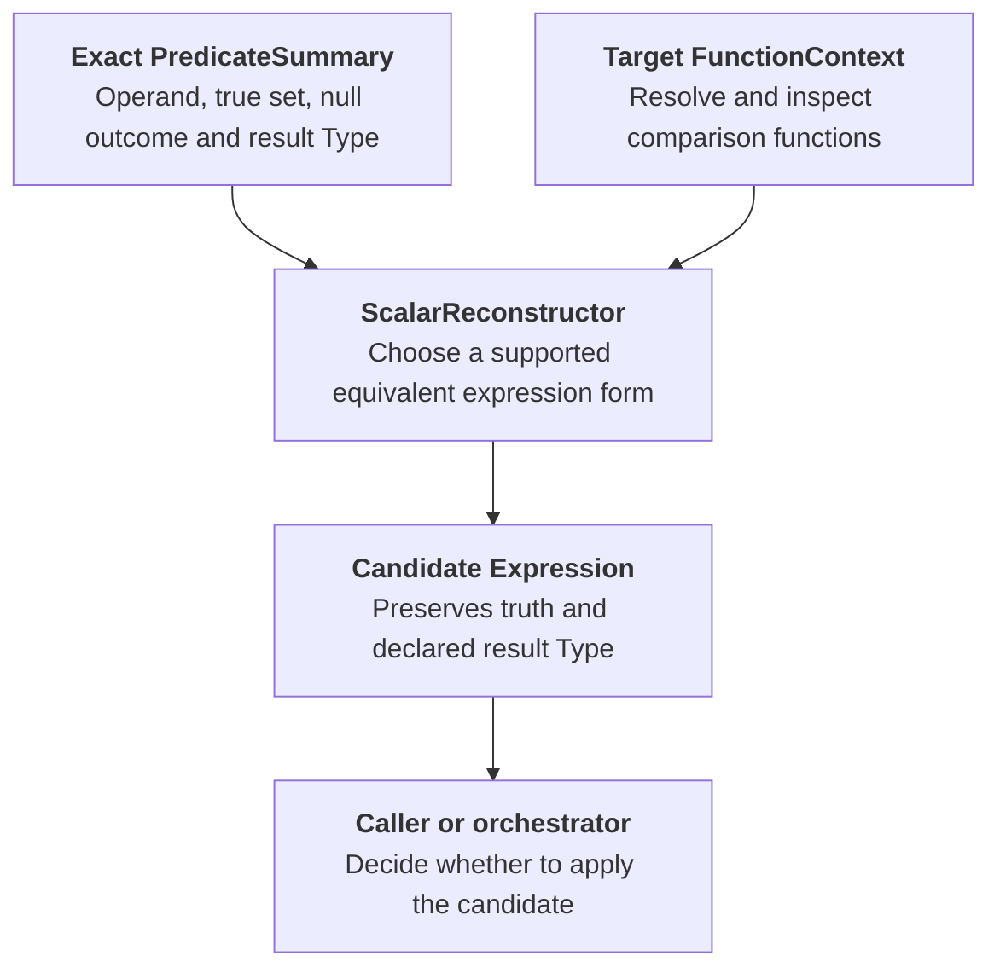
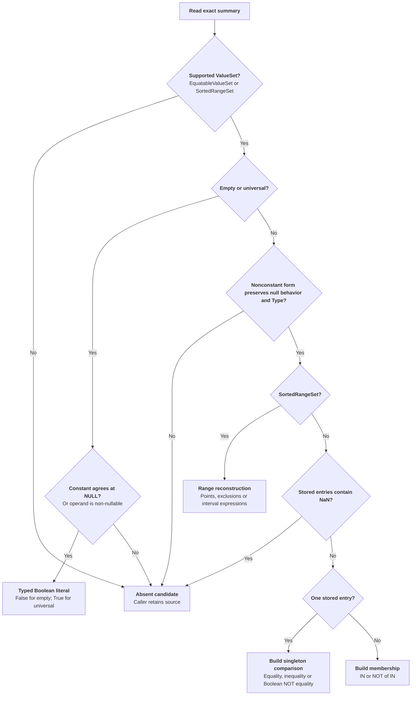
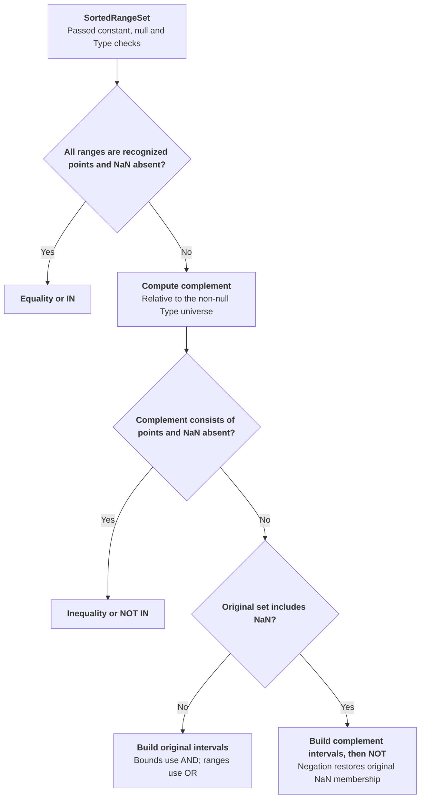
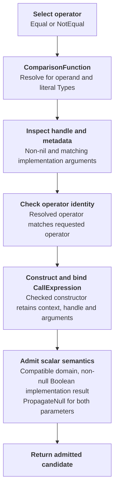

# Scalar reconstruction

Package `reconstruction` turns an **exact predicate summary** into an **equivalent expression candidate**. It converts set-based knowledge back into an expression that other components can evaluate or rewrite. The implementation lives in [scalar_reconstructor.go](scalar_reconstructor.go).

The package supports discrete inclusion/exclusion sets represented by `EquatableValueSet`, `SortedRangeSet` reconstruction, and expression-size reporting.

## Validity boundary

The summary producer establishes valid immutable source input and the exactness of its facts; expressions/utils.ValidateForOptimization can establish graph validity at entry. Reconstruct does not revalidate the source graph. It resolves and checks new target invocations, uses checked construction and retains its NULL/Type admission gates. A successful candidate is valid and equivalent under those contracts; size/cost acceptance remains the caller's decision. Introducing new identities must preserve surrounding canonical key/Type associations.

## Inputs, output and responsibilities

| Input | Information used |
| --- | --- |
| `PredicateSummary.Operand()` | The shared reference expression and its full declared Type. |
| `PredicateSummary.TrueSet()` | Exactly which non-null operand values make the predicate true; other non-null inputs produce False. |
| `PredicateSummary.NullTruth()` | The predicate's result at NULL input, present exactly when the operand is nullable. |
| `PredicateSummary.Type()` | The Boolean result Type the candidate must preserve, including nullability. |
| Target `FunctionContext` | Comparison lookup and metadata used to admit the generated operations. |



The public API is:

```go
func NewScalarReconstructor(context functioninterfaces.FunctionContext) *ScalarReconstructor
func (r *ScalarReconstructor) Reconstruct(
    summary *facts.PredicateSummary,
) (foundation.Optional[expressions.Expression], error)
```

| Return | Meaning |
| --- | --- |
| Present expression, no error | A candidate was constructed under the admitted semantic contracts. |
| Absent expression, no error | The current representation or reconstruction policy provides no candidate; the caller retains `summary.Source()`. |
| Error | A set query, function lookup, metadata/admission check or expression construction failed. |

A candidate is not necessarily smaller than its source. Reconstruction does not apply the candidate, choose among optimization strategies or evaluate functions. It trusts the summary producer's exactness and the admitted provider's semantics; final rewrite safety and cost acceptance belong to the consumer.

Unlike scoped proof, this operation has no `InputDomain` or premise dependencies. It preserves the predicate over its entire declared operand domain. A local fact that NULL cannot occur does not permit discarding `summary.NullTruth()` here.

## Overall decision process

After asserting that the reconstructor and summary are constructed, `Reconstruct` follows this process. Operational errors return immediately and are omitted from the diagram for readability.



The concrete representation is checked first. EquatableValueSet and SortedRangeSet are supported; other ValueSet implementations produce an absent candidate. Both paths share the constant, null-outcome and declared result-Type checks.

## Empty and universal regions: when a constant is faithful

An empty true set says the predicate is False on every **non-null** input. A universal true set says it is True on every **non-null** input. Neither statement alone determines the result at NULL.

For example, with `p = (x == 3)`:

| Source and operand declaration | Non-null true region | NullTruth | Candidate |
| --- | --- | --- | --- |
| `p AND NOT p`, non-nullable `x` | Empty | Absent | `false` |
| `p OR NOT p`, non-nullable `x` | Universal | Absent | `true` |
| `p AND NOT p`, nullable `x` | Empty | Null | Absent: `false` would lose the Null outcome. |
| `p OR NOT p`, nullable `x` | Universal | Null | Absent: `true` would lose the Null outcome. |
| `p AND false`, nullable `x` | Empty | False | `false`, retaining the source result Type. |
| `p OR true`, nullable `x` | Universal | True | `true`, retaining the source result Type. |

A constant Value can have a nullable Boolean Type while holding a non-null payload. For example, a source declared `Bool?` can become a false literal also declared `Bool?`. Here `?` means nullable and `!` means non-nullable; the declaration is preserved even when the result is known.

Empty/universal detection precedes list construction, so reconstruction never emits `IN []`. Universe coverage is semantic: Boolean inclusion of both `false` and `true` is universal even though its stored entry list is nonempty. If a constant would lose the NULL outcome, the current policy returns absence immediately; it does not try to recover a complete finite membership list as a fallback.

## Nonconstant regions: preserving null behavior and Type

Equality, inequality and the generated nonempty IN/NOT IN forms propagate NULL under the admitted contracts. For a nullable operand, the summary must therefore have `NullTruth = Null`. A nonconstant summary whose null-input result is True or False is retained until a suitable expression form is supported.

The generated forms also derive result nullability from the operand. The source's declared Boolean nullability must match that derivation. For example:

```text
Operand Type:       Int64!
Source result Type: Bool?
TrueSet:            {3}
NullTruth:          absent
```

Although `x == 3` has the required truth behavior, it would be declared `Bool!`. Reconstruction returns no candidate rather than narrowing the original result Type or introducing a type-adaptation wrapper. This case can arise from a source such as `(x == 3) AND true`, where the true literal itself has a conservatively nullable Boolean Type.

## Selecting the expression form

For a nonempty, non-universal region that passes the semantic checks:

| Set representation | Example | Candidate |
| --- | --- | --- |
| Singleton inclusion | Include `{3}` | `x == 3` |
| Singleton exclusion | Exclude `{3}` | `x != 3` |
| Boolean singleton exclusion | Exclude `{false}` | `NOT (x == false)` |
| Multiple inclusions | Include `{1, 3}` | `x IN [1, 3]` |
| Multiple exclusions | Exclude `{1, 3}` | `NOT (x IN [1, 3])` |

Excluded entries are values outside the true set; they are not all of its members. Boolean exclusion uses NOT equality so it needs only the standard Boolean equality contract. Other singleton exclusions request the inequality operator. NOT IN is represented as a `LogicalExpression` with NOT around an IN `SpecialFormExpression`; there is no separate NOT IN special form.

For example, suppose scalar analysis has summarized:

```sql
x IN [3, 1, 3] AND x != 1
```

For nullable `x`, the exact summary has true set `{3}` and null outcome Null. Reconstruction shares the original reference, wraps the stored integer Value in a literal expression, resolves equality in the target context and produces `x == 3` with a nullable Boolean result.

Deduplication and ordering have already happened in the set representation. Reconstruction uses `Values()` order: ascending for orderable types and first-occurrence order for Boolean. Thus an inclusion built from `[3, 1, 3]` emits `[1, 3]`; it does not attempt to recover the original SQL list order. Immutable reference and Value instances are shared, while newly constructed expression nodes own their child slices.

## Why float NaN requires a separate check

Set membership and predicate equality have different NaN semantics:

| Operation | Result |
| --- | --- |
| Mathematical membership of NaN in the finite set `{NaN}` | True |
| Native predicate `NaN == NaN` | False |
| Native predicate `NaN != NaN` | True |

Reconstructing an inclusion `{NaN}` as `x == NaN` would lose the matching NaN input. Reconstructing an exclusion `{NaN}` as `x != NaN` would admit the very input that the set excludes. Reconstruction returns no candidate when the stored entries contain NaN, for either polarity.

This differs from encountering NaN in the source syntax. For `x IN [3, NaN]`, exact extraction already removes the nonmatching NaN candidate, leaving the true set `{3}`. Reconstruction can then safely produce `x == 3`.

Signed zeros compare equal under the predicate semantics, so their set normalization is compatible with reconstruction. Positive and negative infinity remain ordinary equality literals.

## Reconstructing ranges

The [range builder](range_reconstruction.go) uses the normalized intervals and separate NaN membership flag of SortedRangeSet. It first tries compact point/exclusion forms, then constructs interval expressions.



For integer examples, with NULL/result-Type checks already satisfied:

| Region | Candidate |
| --- | --- |
| Values below or equal to 9 | `x <= 9` |
| Interval `[1, 10]` | `x >= 1 AND x <= 10` |
| Point ranges `{1}` and `{10}` | `x IN [1, 10]` |
| All values except 3 | `x != 3` |
| All values except 1 and 10 | `NOT (x IN [1, 10])` |
| Values below 1 or above 10 | `x <= 0 OR x >= 11` |

Integer range construction has already normalized open bounds to closed successor/predecessor bounds. Reconstruction follows those bounds, rather than recovering the original text. Float and VARCHAR intervals preserve their strict/inclusive cuts.

A point is recognized by comparing an interval with the canonical point range of one of its closed endpoints. This also handles integer extrema, float infinities and VARCHAR extrema whose bounds may normalize to unbounded. The builder does not enumerate interval contents. Open-only intervals that happen to contain one representable value remain valid interval expressions instead of receiving the point optimization.

### Float ranges and NaN

A fully unbounded float interval includes every ordered float value but **excludes NaN**. It becomes `x >= -Inf`, not a true literal. Both infinities pass that comparison; NaN does not.

If the original set includes NaN, the builder can represent its ordered complement and negate it:

| Float region | Candidate or strategy |
| --- | --- |
| Every non-NaN value | `x >= -Inf` |
| Only NaN | `NOT (x >= -Inf)` |
| Values where `x < 10` is not True on non-null input | `NOT (x < 10)`, which includes NaN |
| Every value except 3, including NaN | `x != 3` |
| Every ordered value except 3, excluding NaN | `x < 3 OR x > 3` |

The last two rows differ: inequality admits NaN, whereas the disjunction of ordered comparisons rejects it. The complement shortcut therefore requires that the excluded point set itself contain no NaN. All these nonconstant forms retain null propagation; none globally changes a nullable operand's Type.

## Reporting candidate and source sizes

[MeasureExpression](expression_size.go) lets callers compare a candidate with its original source:

```go
type ExpressionSize struct {
    NodeCount        int
    LiteralOccurrences int
    MembershipEntries  int
}
func MeasureExpression(expression expressions.Expression) ExpressionSize
```

NodeCount counts expression nodes including the root; LiteralOccurrences counts literal nodes; MembershipEntries counts IN candidate positions, excluding the target operand. A shared subtree counts at each occurrence. These counts describe structure, not execution cost, encoded bytes or distinct allocations.

For example, an exact range summary of `x IN [1, 2, 10, 11]` contains two integer intervals. It can produce:

```sql
(x >= 1 AND x <= 2) OR (x >= 10 AND x <= 11)
```

| Expression | NodeCount | LiteralOccurrences | MembershipEntries |
| --- | --- | --- | --- |
| Original IN | 6 | 4 | 4 |
| Range candidate | 15 | 4 | 0 |

The larger candidate remains a valid expression, but the caller may prefer the original. Reconstruct returns a candidate without overwriting `summary.Source()` or making this acceptance decision. Measurement is a separate operation, so the caller chooses which expressions to measure.

## Resolving and admitting target functions

A summary does not supply the handle for the expression being generated. Singleton and range reconstruction request the appropriate operator from the target context using the shared [ResolveComparison helper](../internal/function_admission/resolve_comparison.go).



The constructor is the single binding authority for generated comparison calls. Semantic admission uses its effective signature; an unadmitted constructed candidate is discarded. Stored-call analysis separately trusts entry-established validity and does not repeat handle/signature validation.

Membership uses the related `CheckMembershipEquality` helper to resolve and admit Equal before building the list. An IN expression stores neither a handle nor a function context, so its consuming interpreter or adapter must provide the same admitted equality semantics.

These checks inspect contracts without executing the functions. A nil handle, mismatched operator, inconsistent signature or unavailable lookup returns an error. In particular, `ErrUnsupportedLookup` is still an error; it does not become an absent successful reconstruction. The target provider's implementation of the admitted semantics remains trusted.

## Boundaries and verification

The zero reconstructor is invalid. Construct it with `NewScalarReconstructor`, supply a constructed exact summary, and keep both inputs immutable. Required nil or unconstructed inputs assert; non-nil operational failures return errors.

A list with n stored entries requires O(n) new expression nodes. Range construction uses O(r) interval/complement work and O(r) nodes for r normalized ranges, plus endpoint payload and provider costs. Measurement takes O(n) time over n expression occurrences and can hold O(n) pending nodes. The caller remains responsible for deciding whether a candidate improves the original expression.

The [reconstruction tests](tests/scalar_reconstructor_test.go) compare source and candidate interpretation and re-extract nonconstant candidates to check their summaries. They cover Boolean, integer, VARCHAR and float domains, nullable inputs, constant cases, list order, immutable sharing, signed zeros, infinities and NaN. The [range tests](tests/range_reconstruction_test.go) additionally cover interval boundaries, point/exclusion selection, range round trips, float NaN regions and size reporting. The [provider tests](tests/provider_errors_test.go) verify metadata-only construction, contract checks and error propagation.
