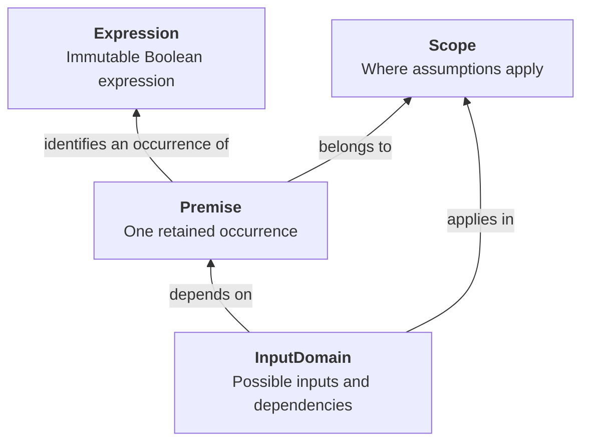
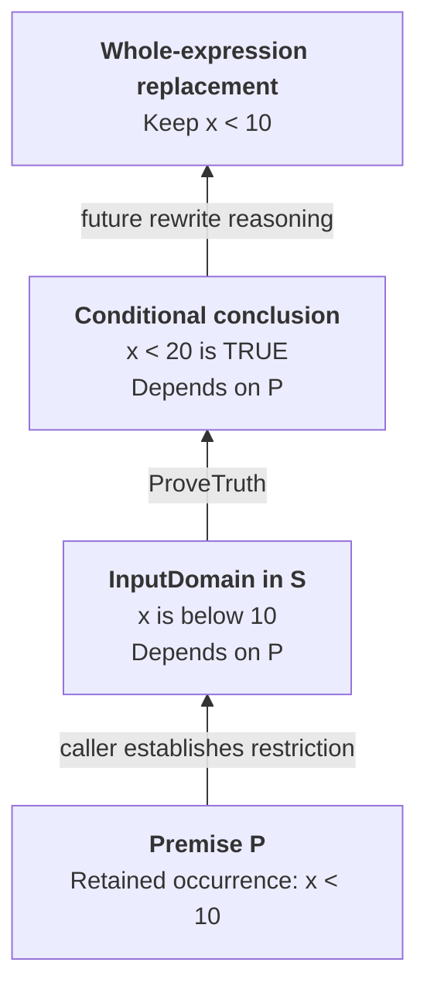
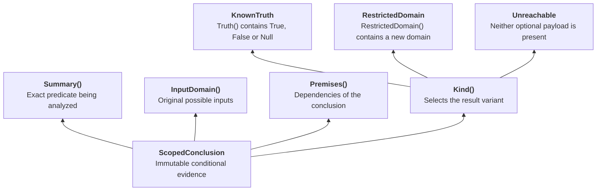
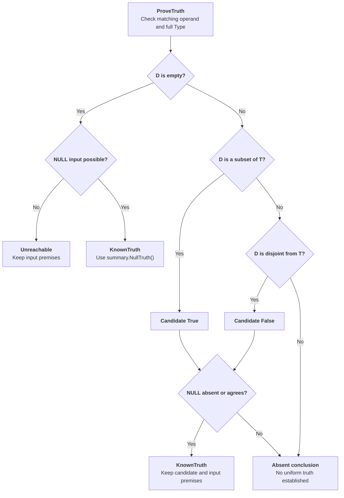
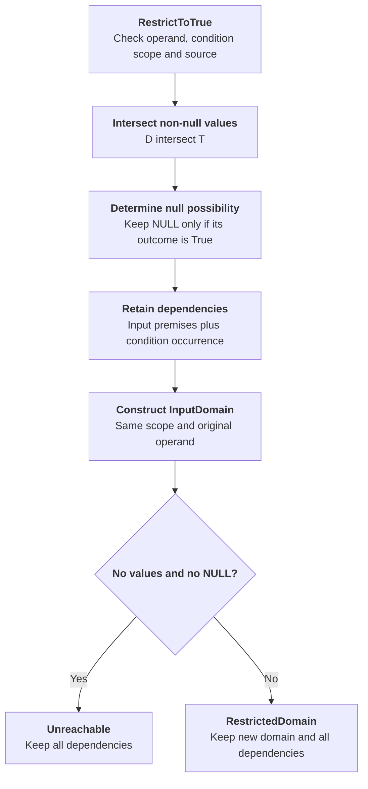
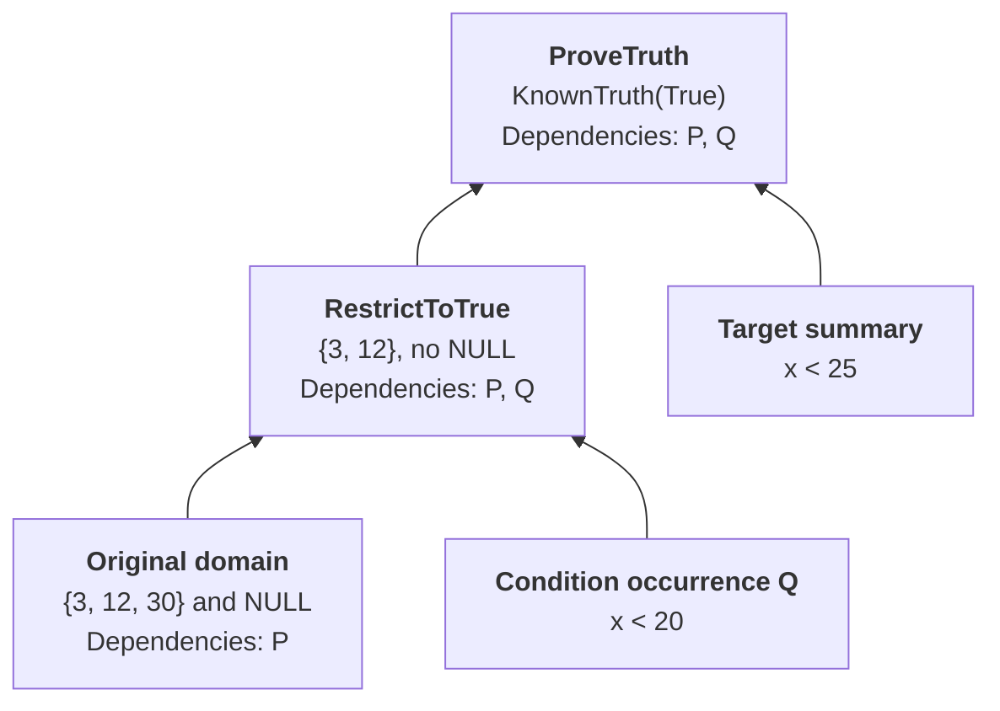
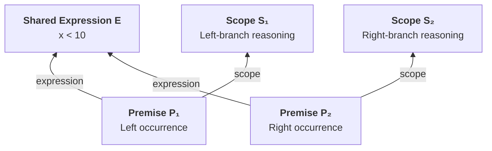

# Scoped reasoning

Package `scoped_reasoning` records **where an assumption applies** and **which retained expression occurrence it depends on**. It supplies input domains, occurrence identities, and scoped proof and restriction queries over exact predicate summaries. The [contextual rewriter](../../concrete_rewriters/scoped_contextual_rewriter/README.md) applies these conclusions to expression trees.

The package comment and exported declarations provide Go API documentation. This README explains their relationships and intended use.

## Concepts and relationships

| Type | Meaning | Current responsibility |
| --- | --- | --- |
| `Scope` | Identity of one reasoning context | Separates assumptions and registers premise occurrences. |
| `Premise` | Identity of a retained Boolean expression occurrence | Records the expression and its scope. |
| `InputDomain` | Possible inputs under specified assumptions | Carries values, null possibility and premise dependencies. |
| `ScopedConclusion` | Evidence relative to an input domain | Records uniform truth, a conditional restriction or unreachable inputs, with dependencies. |



## Scope: where a restriction applies

Consider this predicate, with **non-nullable integer `x`**:

```sql
x < 10 AND x < 20
```

For inputs where the first conjunct is true, `x` is below 10. Within that setting, `x < 20` must also be true.

A caller can create scope `S`, register the first conjunct as premise `P`, establish the corresponding value set and construct an input domain:

```text
Scope          = S
Operand        = x
PossibleValues = integers below 10
NullPossible   = false
Premises       = [P]
```

The scope identifies the setting; the `InputDomain` contains the restriction. A scope alone contains no information about possible values or nullability.

Currently, scopes are independent identities. They have no parent relationship, automatic inheritance or association with a particular expression-tree path. The caller decides what each scope represents. An input domain retains its scope even when its premise list is empty.

## Premise: which occurrence supports a restriction

For the example above, the intended reasoning is:



This supports simplifying the whole expression to `x < 10`. It does not establish that `x < 20` is globally true: `x = 30` disproves that. Keeping the dependency on `P` records the conditional nature of the conclusion. Deleting that premise would require another justification.

The package represents premises and input domains and exposes proof queries. The caller remains responsible for applying a conclusion while retaining its premises. For nullable operands, a whole-expression replacement must also preserve the result at NULL input; knowledge about passing rows alone does not establish that equivalence.

## ScopedConclusion: evidence with its assumptions

[scoped_conclusion.go](scoped_conclusion.go) introduces `ConclusionKind` and `ScopedConclusion`. A conclusion records what a query established, which predicate it examined, which input domain it used and which premises support the result. It preserves enough context for a later consumer to interpret the evidence.



| Kind | Meaning | `Truth()` | `RestrictedDomain()` |
| --- | --- | --- | --- |
| `KnownTruth` | The predicate has the same result for every possible input in the supplied domain. | Present, including for a known `foundation.Null`. | Absent. |
| `RestrictedDomain` | The new domain contains the supplied possible inputs for which the predicate is true. | Absent. | Present. |
| `Unreachable` | No input remains possible under the conclusion's dependencies. | Absent. | Absent. |

`InputDomain()` always returns the **original** input domain. The narrower output, when present, is returned by `RestrictedDomain()`. `Scope()` comes from the original input. `Summary()` retains the exact predicate summary, including its source expression and result Type.

The tagged struct has private fields and is created by the queries. Its zero value is invalid. The optional payloads distinguish an absent truth from `False`, which is the zero value of `TruthValue`. Premise slices are copied at the accessor boundary; immutable summaries, domains and tokens are shared.

## Scoped queries: proving versus restricting

The package functions in [queries.go](queries.go) consume an exact `facts.PredicateSummary` and an `InputDomain`. They require matching column identity and full declared Type, including nullability. Two sets over Int64 cannot be combined as facts about one input if one describes column `x` and the other describes column `y`.

| Query | Question answered | Dependencies |
| --- | --- | --- |
| `ProveTruth(summary, input)` | Does this predicate have a uniform result over the possible inputs? | All input premises. |
| `RestrictToTrue(summary, input, condition)` | Which possible inputs remain if this predicate is required to be true? | All input premises plus the condition occurrence. |

`ProveTruth` returns `(foundation.Optional[ScopedConclusion], error)`; `RestrictToTrue` returns `(ScopedConclusion, error)`. There are four distinct situations:

- A present `KnownTruth(Null)` means the predicate result is known to be SQL NULL.
- An absent conclusion with no error means ProveTruth established no uniform truth over the supplied inputs.
- An `Unreachable` conclusion means no inputs remain possible under the dependencies.
- An error means the operation failed, including an unsupported exact set operation.

`RestrictToTrue` returns a conclusion directly on success: `RestrictedDomain` or `Unreachable`. These functions use explicit arguments; they need no mutable fact registry or evaluation context.

### ProveTruth: test whether every possible input agrees

Let `D` be `input.PossibleValues()` and `T` be `summary.TrueSet()`. Both contain only non-null values. The exact summary guarantees that the predicate is true inside `T` and false outside `T` for non-null inputs. Its separate `NullTruth()` describes the result when the operand is NULL.

The implementation first checks operand compatibility, then follows this process:



Set-query errors return immediately; they are omitted from the diagram for readability. The empty-domain check precedes subset/disjoint checks so that empty inputs yield Unreachable rather than an arbitrary vacuous True or False.

For `x < 20` with non-null inputs `{1, 3}`, every input lies in the true region, so the answer is KnownTruth(True). With `{30}`, the sets are disjoint, so the answer is KnownTruth(False). With `{1, 30}`, the inputs disagree and the answer is absent.

If `x` is nullable and the domain contains `{1}` plus NULL, the non-null candidate is True but the null-input result is Null. There is no uniform result. If only NULL is possible, the result is KnownTruth(Null). A nullable declared Type alone does not force that comparison: `input.NullPossible()` determines whether NULL is possible in this particular scope.

The proof copies the input dependencies. It does not add the analyzed predicate as a premise, because it has established the outcome without assuming that predicate true. If the domain overapproximates actual inputs, an absent proof over that larger domain does not establish variation over the actual inputs.

### RestrictToTrue: keep inputs where the condition passes

The condition premise supplies the additional assumption: this particular occurrence is required to be true. Before restricting inputs, the implementation checks that the premise belongs to the input scope and its expression is structurally equal to the summary source. Structural equality admits independently built copies; the caller remains responsible for associating the token with the actual retained occurrence.

With the same notation as above, the new domain is:

```text
PossibleValues = D intersect T
NullPossible   = input.NullPossible AND (summary.NullTruth == True)
Premises       = input.Premises followed by condition, deduplicated by identity
```



As with ProveTruth, errors propagate rather than becoming a successful conclusion. For `x < 20`, starting with `{1, 30}` plus NULL produces `{1}` with `NullPossible = false`: false and NULL predicate results do not pass. The reference still has its original nullable Type; the restriction is local to the domain.

NULL is not always removed. For `(x < 20) OR true`, the null-input result is True, so a previously possible NULL remains possible. For `(x < 20) AND false`, no input passes. These outcomes come from `summary.NullTruth()` and `summary.TrueSet()`, without evaluating expressions in the query.

The condition dependency remains even if the value set is unchanged or empty. In particular, Unreachable from a restriction does not mean the predicate was uniformly false: a null-only domain restricted by `x < 20` is also unreachable, although the predicate's result there is Null.

### Comparing the outcomes

For the null-propagating predicate `x < 20`:

| Possible inputs | ProveTruth result | RestrictToTrue result |
| --- | --- | --- |
| `{1, 3}` | KnownTruth(True) | RestrictedDomain containing `{1, 3}` |
| `{30}` | KnownTruth(False) | Unreachable |
| `{1, 30}` | Absent | RestrictedDomain containing `{1}` |
| Only NULL | KnownTruth(Null) | Unreachable |
| `{1}` and NULL | Absent | RestrictedDomain containing `{1}`, with null excluded |
| No inputs | Unreachable | Unreachable |

The NULL rows assume nullable `x`. Every restriction result retains the condition premise, including the Unreachable results. Every proof result retains just the input dependencies.

### Combining restriction and proof

Suppose the input domain contains `{3, 12, 30}` and NULL, with existing dependencies `[P]`. Register occurrence `Q` of `x < 20` in the same scope. Restricting by Q gives `{3, 12}`, excludes NULL and carries dependencies `[P, Q]`.

Now analyze `x < 25` against that restricted domain:



The second query establishes the target's truth under Q. It does not authorize deleting Q. The original domain includes 30 and NULL, where the target is not True. Applying this evidence to a whole expression still requires the later contextual rewriter to preserve the supporting premises and full three-valued semantics.

These processes are exercised by the [query tests](tests/queries_test.go), including interpreter comparisons, finite/range domains, null-only and empty inputs, retained dependencies and propagated errors.

## Occurrence identity and shared expressions

An immutable expression object `E` representing `x < 10` may appear twice:

```sql
(x < 10 AND a) OR (x < 10 AND b)
```

Both positions can point to the same `Expression` object. Retaining the left occurrence and retaining the right occurrence are nevertheless different obligations.



Each call to `RegisterPremise` creates a fresh identity, even for the same expression in the same scope. The following Go helper demonstrates this behavior. Its argument must be a constructed Boolean expression; the import alias is local to the example.

```go
package example

import (
	scoped "github.com/lie-yan/predicate-optimization/analysis/scoped_reasoning"
	"github.com/lie-yan/predicate-optimization/expressions"
)

func distinctOccurrences(expr expressions.Expression) (bool, error) {
	scope := scoped.NewScope()

	first, err := scope.RegisterPremise(expr)
	if err != nil {
		return false, err
	}
	second, err := scope.RegisterPremise(expr)
	if err != nil {
		return false, err
	}

	return !first.EqualsTo(second), nil // Always true after successful registration.
}
```

The caller associates registrations with actual occurrences; registration does not traverse the tree or discover their positions. When referring again to an already registered occurrence, reuse its token. Copying a `Scope` or `Premise` struct also preserves identity because the copy points to the same private identity record. Compare tokens through `EqualsTo`; comparing wrapper pointers would distinguish such copies.

## Scope ownership and identity implementation

Each `Scope` registers its own premise occurrences. `InputDomain` rejects premise dependencies from another scope; no separate context owner or fact registry is needed.

The private records in [premise.go](premise.go) and [scope.go](scope.go) make identity checks simple pointer comparisons. They avoid requiring expressions or caller-provided column IDs to be comparable Go map keys. The `marker byte` makes the scope identity allocation nonzero-sized: Go permits pointers to distinct zero-sized variables to compare equal.

Tokens are shared as immutable objects. Their identity is independent of expression equality and value-set compatibility. `InputDomain` copies its dependency slice, deduplicates entries by premise identity in first-occurrence order and returns a fresh slice from `Premises()`.

## Construction contracts and proof responsibility

Use the constructors to obtain domains, `NewScope` to obtain scopes, and `RegisterPremise` to obtain premises. Their zero values are invalid. Required nil inputs and unconstructed tokens trigger assertions; incompatible non-nil inputs return errors. For example, registering a non-Boolean expression or using a premise from another scope returns an error.

Successful registration of `x < 10` does not prove it or derive a range automatically. The caller establishes the restriction, supplies its complete premise dependencies and retains the supporting occurrences when applying a conclusion. An empty dependency list can represent independently established inputs, but does not itself prove the supplied restriction. Callers must preserve scope and dependency validity; registration alone does not establish those proofs.
