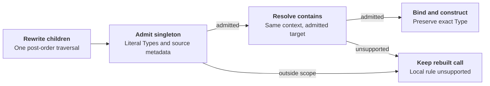

# Array membership normalization rewriter

The public rule normalizes admitted singleton contains-any calls through their paired function contexts.

## Current transformation

```sql
array_contains_any(category_ids, [8792001]) → array_contains(category_ids, 8792001)
NOT array_contains_any(mall_ids, [8793001]) → NOT array_contains(mall_ids, 8793001)
```

Here E is any non-null element Type for which the paired context supplies compatible membership overloads with the same equality semantics. Int64 is the standard testbed example; the rule has no element-family whitelist. Float and composite equality remain provider-defined.

The rule admits Array<E!> inputs with nullable or non-nullable outer Types. Candidate arrays must be non-null literals with exactly one E! element. Empty, multiple, dynamic and unsupported candidate forms retain their calls. Duplicate candidates such as `[8792001, 8792001]` remain multiple candidates.

Callers supply stable, correct, effect-free and successful admitted membership implementations, including outer-array null propagation. Metadata identifies the operations and policies; it cannot prove execution availability. Array exclusion grouping remains a separate rule.

## Public use and traversal

```go
rule := array_membership_normalization_rewriter.NewArrayMembershipNormalizationRewriter()
tree := rewriter.NewExpressionTreeRewriter[struct{}](rule)
result, err := tree.Rewrite(input, struct{}{})
```

The [runnable example](../../examples/rewriting/array_membership_normalization_test.go) builds a nullable Int64 array reference with the paired standard provider, prints before/after trees and checks exact Type, unchanged structural counts, second-pass identity and independent hit/miss/empty/NULL evaluation. Run from the repository root:

```sh
go test ./examples/... -run '^Example_arrayMembershipNormalization$' -v
go test -tags debug ./examples/... -run '^Example_arrayMembershipNormalization$' -v
```

The constructor has no FunctionContext argument. Each call supplies its own paired context for source metadata, target lookup and construction. Inputs are valid, non-nil and immutable; the rule retains no provider or attempt state. Invocation belongs outside active scoped attempts so later scoped passes derive fresh source associations. Scheduling and repetition remain explicit caller choices.

The typed RewriteCall callback first uses DefaultRewrite to process children, then attempts local normalization. It returns a present rebuilt call when the local rule declines, preserving accepted child changes without traversing them again. Other expression variants inherit ordinary traversal.



## Validity boundary

Establish valid immutable input once with expressions/utils.ValidateForOptimization, or controlled construction preserving graph-wide identity/Type consistency. Source metadata is read to recognize membership semantics, not to revalidate its stored signature. The replacement is a new invocation: paired lookup, target admission, checked construction and the exact result-Type check remain necessary. Success returns a valid equivalent tree; errors return no partial tree. Normalization and exclusion grouping have separate semantic obligations.

## Admission and errors

Both implementation signatures use non-null parameters/results and policies `[PropagateNull, NullPolicyUnspecified]`: contains-any takes two Array<E!>! arguments; contains takes an Array<E!>! and E!. Neither metadata record has arithmetic/comparison classification. Actual input arrays may be nullable, producing Bool? for both calls. NewCallExpression derives the effective signature; one local check accepts the candidate only when its full result Type equals the source.

Shared [metadata recognition](../internal/array_membership/metadata.go) and [lookup-error classification](../internal/array_membership/lookup_error.go) now live in the internal array_membership package, shared with array grouping. Candidate shape and checked replacement construction remain local to this rule.

Only explicit target lookup may treat ErrUnsupportedLookup as a local miss. Recognized contract, handle, execution-failure or availability categories take precedence in wrapped/joined errors. Source/target metadata and final NewCallExpression failures always propagate; public Rewrite returns no tree. Checked construction is the sole binding step in the rule and intentionally queries metadata through the normal API. The former speculative binding was removed in validation V.9; successful singleton query counts remain three metadata queries and one built-in lookup. Failed attempts leave the source available for retry.

No Evaluate or environment lookup occurs during rewriting. The replacement retains the input-array expression and shares the sole immutable element Value in a new scalar literal. Candidate payload inspection uses Elements, which currently copies the slice even when its length later excludes normalization. Total work includes inspected candidate payload sizes and provider metadata/lookup/construction costs as well as expression traversal. This rule introduces no cache, Value accessor or measured speedup claim.

One array literal becomes one scalar literal, so expression node/literal/IN-entry counts do not decrease. Acceptance is the canonical call form. A subsequent unchanged pass retains identity because the replacement is already contains.

## Traversal, sharing and ownership

The [Tests](tests/traversal_test.go) observe reference/opaque callbacks and delegate Call callbacks to the actual rule. Shared expression instances are visited once per occurrence, in stored order. Call completion is post-order: children normalize before enclosing calls are reconstructed or considered for local normalization. A locally unsupported parent returns its rebuilt result, preserving child work without traversing those children again.

For example, an unclassified array producer can retain a normalized Boolean argument while the outer membership also normalizes:

```text
array_contains_any(producer(array_contains_any(A, [8792001]), opaque_array, flag), [8793001])
  → array_contains(producer(array_contains(A, 8792001), opaque_array, flag), 8793001)
```

The producer retains its handle/context and its other argument instances. Source nodes, copied child slices and literal element slices remain unchanged; scalar candidate literals share the original element Values. Separate replacements for shared source occurrences may or may not share identity. A second pass still visits occurrences but returns the same root and makes no metadata, lookup or evaluation calls in these fixtures. The metadata-only producer establishes structural behavior, not executable equivalence; retained execution is verified separately below.

MeasureExpression counts remain `17 nodes / 4 literals / 1 IN entry` in the logical/shared fixture and `8 nodes / 2 literals / 0 IN entries` in the nested-producer fixture. Their singleton contains-any counts decrease from three and two respectively to zero. This checks normalization of call form without demanding node reduction or claiming an evaluation speedup. Provider-boundary coverage includes enclosing reconstruction failure after tentative child work: no partial tree is published.

## Provider failure boundaries

The [Tests](tests/provider_boundaries_test.go) exercise source metadata, target lookup, target metadata, checked target construction and enclosing-call reconstruction independently. Each phase receives a wrapped unsupported cause, alone or joined with unknown-handle, incompatible-handle, contract, evaluation-failure, unavailable or disallowed categories. Only the plain unsupported explicit lookup declines locally; the other cases propagate all causes without publishing a partial tree.

An enclosing NOT call uses a separate provider. Its injected reconstruction failure happens after the child has normalized, verifying that tentative descendant work is not published and each call retains its own context. Removing faults and retrying with the same tree service and original input produces the independently built expected tree. Separate catalogs with identical function names remain distinct; foreign replacement handles fail through the source's paired context. Ordinary and non-comparable wrapped handles cover both these paths, and successful replacements preserve Bool! or Bool? exactly. The existing wrong-overload test separately covers constructor binding failure. No test requires evaluation during rewriting or treats metadata availability as proof of executable equivalence.

## Membership truth and declared nullability

The [Semantic tests](tests/semantics_test.go) evaluate source and generated predicates separately against an ordinary integer-membership oracle. They cover candidates 8792001/8793001, negative and zero values, Int64 extrema and neighboring values, empty arrays, hits/misses, duplicate elements and first/last hits. Ordinary and non-comparable wrapped handles, nullable/non-nullable inputs and positive/NOT forms produce 504 cases. The expected complete Boolean Type comes from declared input nullability, independently of the generated expression: a concrete True or False can still carry Bool?.

Empty arrays produce False for positive membership; typed NULL arrays produce NULL. NOT reverses concrete membership truth and preserves NULL. Another 24 cases put a known NULL array literal directly into the source call. The generated tree must still contain array_contains with that literal, rather than fold to a NULL Boolean literal. Rewriting performs no evaluation. Int64 is the standard provider example; the rule remains generic over admitted element Types, with separate generic-element fixtures. This evidence verifies the testbed contracts, not live Milvus compatibility or an exhaustive proof.

## Retained execution and first failures

The [Execution tests](tests/evaluation_behavior_test.go) interleave reference lookups and caller-owned function invocations in one trace. For example, with a shared membership node appearing twice:

```text
AND(before(), ANY(producer(array), [8792001]), ANY(producer(array), [8792001]), after())
retained trace: before, array, producer, array, producer, after
```

Replacing each ANY with contains preserves this trace, including both executions of the shared producer. Membership calls are counted separately and checked against their respective built-in names. Direct, NOT, AND, OR and enclosing-call placements use ordinary and non-comparable wrapped handles. Decisive Boolean siblings still evaluate all operands under the prototype interpreter's eager policy.

Producer values, typed NULL, sentinel failures, reference lookup failures and enclosing failures preserve their results or first error. Opaque input and a producer without an executor remain unavailable; they never become NULL. When a producer fails, a later failing sibling is never reached. A NULL producer still reaches membership null propagation and later siblings. Normalization itself performs no evaluation or environment lookup. The 86 cases verify this interpreter's policy without claiming that every Milvus executor uses the same order.

## Missing input versus known NULL

The [Partial-evaluation tests](tests/partial_evaluation_test.go) treat missing array bindings as indeterminate input, including for non-nullable columns. Source and normalized calls retain residual expressions of the exact declared result Type. For example:

```text
source:     flag AND array_contains_any(array, [8792001])
normalized: flag AND array_contains(array, 8792001)

flag = true, array absent:
  residual source:     true AND array_contains_any(array, [8792001])
  residual normalized: true AND array_contains(array, 8792001)

complete either residual with array = [8792001]: true
complete either residual with array = []:     false
complete either residual with array = NULL:   NULL (nullable array only)
```

The known flag becomes a literal, so completing a residual requires only the array binding. A present typed NULL produces a known result during partial evaluation. Missing input remains residual even with a decisive sibling (`false AND ...` or `true OR ...`), following the interpreter's eager policy. Known NULL membership under those siblings instead yields a known False or True, retaining Bool? when the array is nullable.

The 80 fixtures cover positive/NOT forms, direct and AND/OR groups, both nullabilities, two candidates and both handle representations. Completing the two residuals independently across 440 input cases checks truth and full Types against an independent oracle and full-input evaluation. Missing input never invokes membership; complete evaluation while it remains absent reports ErrUnavailableInput. Normalization itself performs no evaluation.

## Composition and touchstone coverage

The [composition tests](tests/composition_test.go) run two explicit schedules, allowing each pass to finish before starting the next:

```text
Normalization → Scoped contextual rewriting → Boolean cleanup → Logical flattening
Scoped contextual rewriting → Boolean cleanup → Logical flattening → Normalization
```

The [touchstone tests](tests/touchstone_test.go) independently assemble the resulting scalar intermediate from columns and constants. Both schedules produce category/mall exclusions using `array_contains(category_ids, 8792001)` and `array_contains(mall_ids, 8793001)`, with all seven tag exclusions still separate. Both match the expected tree and its `63 nodes / 28 literals / 19 IN entries`. The normalization pass changes exactly the two singleton calls, sharing their array arguments and candidate Values; it preserves structural counts. Each pass preserves full Types, graph validity and immutable inputs.

Complete rows exercise article choices, every excluded tag, review/brand restrictions, empty and duplicate arrays, category/mall restrictions and combinations of nullable fields. The nullable-article schema still admits category/mall normalization, but contextual guard reductions remain blocked. After flattening it retains `110 nodes / 57 literals / 46 IN entries`. With NULL article_type and tag 8791004, all stages still evaluate NULL; the proposed final grouped fixture instead evaluates False. This keeps the nullability boundary visible.

These tests exercise an explicit pass schedule. Add the [array exclusion grouping pass](../array_exclusion_grouping_rewriter/README.md) to obtain the final primary touchstone result.

## Paired test fixtures

The external test package supplies typed construction helpers and an Environment resolving ColumnIDs through EqualsTo, distinguishing missing input from typed NULL. A recording context logs metadata, lookup and evaluation and permits targeted faults after valid construction, including a failure on the second target metadata query. Successful metadata and handle meanings stay stable.

Alternative catalogs omit contains or expose valid out-of-scope signatures/policies. Metadata-only catalogs are construction/admission fixtures, not evidence of executable equivalence. A slice-bearing caller-defined handle is non-comparable; its matching context translates all handle operations and rejects foreign wrapper domains. Both ordinary and wrapped standard contexts now exercise actual normalization.

## Files and verification

| File | Responsibility |
| --- | --- |
| [array_membership_normalization_rewriter.go](array_membership_normalization_rewriter.go) | Public constructor and post-order typed callback. |
| [admission.go](admission.go) | Singleton literal/type shape. |
| [Shared membership metadata](../internal/array_membership/metadata.go) and [lookup errors](../internal/array_membership/lookup_error.go) | Generic semantic-family recognition and stronger-failure precedence. |
| [normalization.go](normalization.go) | Paired lookup, binding, construction and phase-specific error handling. |
| [Unchanged-tree tests](tests/array_membership_normalization_rewriter_test.go) | Identity, full Types, grouping and sharing across current variants without singleton candidates; forbid provider queries/evaluation on shape misses. |
| [Generic element fixtures](tests/generic_elements_test.go) | Integer widths, Boolean, bounded VARCHAR, float (including NaN and signed zero), nested arrays and structs with paired executable overloads. |
| [Caller-side fixtures](tests/fixtures_test.go) | Typed construction, recording/faulting contexts, scoped bindings, alternative metadata and non-comparable paired handles. |
| [Fixture contract tests](tests/fixtures_contract_test.go) | Paired evaluation/normalization, missing/NULL/error distinction, faults/retry, missing overloads and identity domains. |
| [Admission tests](tests/admission_test.go) | Candidate shape, full element constraints, source/target metadata, misleading names and incompatible target signatures; unchanged identity and no evaluation. |
| [Query-contract tests](tests/query_contract_test.go) | Three metadata queries and one target lookup in order, with ordinary/non-comparable handles and both nullabilities. |
| [Normalization tests](tests/normalization_test.go) | Direct/negated replacement, nullable input Types, retained instances, idempotence, missing overload, phase-specific failures, constructor binding failure after a wrong-overload lookup, and clean retry. |
| [Provider boundary tests](tests/provider_boundaries_test.go) | Phase/category matrix, enclosing failure after tentative child work, distinct-catalog pairing, foreign handles, exact Types and retry. |
| [Traversal tests](tests/traversal_test.go) | Post-order visits per occurrence, shared inputs/Values, unsupported parents, immutable slices, size preservation and second-pass identity. |
| [Execution tests](tests/evaluation_behavior_test.go) | Retained argument/sibling traces, shared occurrences, typed NULL, first failures and unavailable execution. |
| [Partial-evaluation tests](tests/partial_evaluation_test.go) | Missing versus typed NULL, known sibling substitution, residual completion, independent truth and exact Types. |
| [Composition tests](tests/composition_test.go) | Explicit completed-pass schedules, exact local replacement checks, immutable inputs and Boolean cleanup composition. |
| [Touchstone tests](tests/touchstone_test.go) | Independently assembled 63-node intermediate, complete rows, nullable-article boundaries and seven ungrouped tag exclusions. |
| [Semantic tests](tests/semantics_test.go) | Independent integer oracle, positive/NOT truth, nullable result Types, Int64 boundaries and known-NULL literal normalization. |

From the repository root:

```sh
go test ./concrete_rewriters/array_membership_normalization_rewriter/...
go test -tags debug ./concrete_rewriters/array_membership_normalization_rewriter/...
```

Singleton normalization is implemented. Array exclusion grouping is a separate pass; this rule alone does not produce the final grouped touchstone output. General scheduling, revisits, bounded-work fallback, and live Milvus validation remain open.
