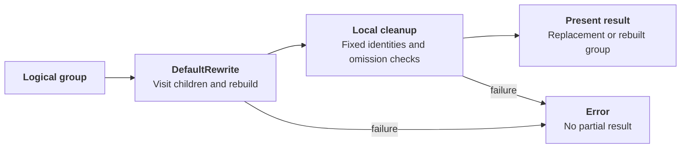

# Boolean cleanup rewriter

`BooleanCleanupRewriter` simplifies Boolean structure using fixed identities. It is independent of scalar extraction and scoped contextual reasoning: it carries no guard assumptions, premises or occurrence paths. It can run after constant folding, contextual rewriting or another transformation.

```go
rule := boolean_cleanup_rewriter.NewBooleanCleanupRewriter(factory, functionContext)
tree := rewriter.NewExpressionTreeRewriter[struct{}](rule)
result, err := tree.Rewrite(input, struct{}{})
```

Supply a non-nil ValueFactory as `factory` to construct replacement values. The supplied non-nil FunctionContext provides IN equality admission; CallExpressions retain their own paired contexts. Supported comparisons, Boolean NOT and array membership must have correct, stable, effect-free and successful evaluation on valid effective inputs, including null behavior. Complete reference bindings must be stable, successful and effect-free. Rewriting may inspect metadata and bind rebuilt calls, but never evaluates functions or reads an interpreter environment.

Callers establish valid immutable input once at entry with `expressions/utils.ValidateForOptimization`, or by controlled construction preserving graph-wide identity/Type consistency. Stored-call eligibility trusts that binding and reads metadata only for semantic recognition; it does not revalidate the handle/signature. Newly resolved IN equality still receives shared inspection and binding, and rebuilt calls use checked constructors. Omission eligibility and exact changed-child Type checks remain separate from input validity. Successful rewriting preserves validity and equivalence or returns an error; input validity alone never licenses omission.

## Post-order behavior

Children are rewritten before their logical parent. For example:

```text
NOT(True AND False)
          ↓
     NOT(False)
          ↓
         True
```

The logical callback calls `DefaultRewrite` to visit children without invoking itself at the same node, then applies shared cleanup to the rebuilt group. If no identity applies, it returns the rebuilt group as a present replacement; returning absence here would visit the children again. Other expression variants inherit ordinary traversal, allowing cleanup inside call arguments while preserving function bindings and declared Types.



## Identities and boundaries

| Form | Result and condition |
| --- | --- |
| `NOT False`, `NOT NULL` | Typed True, typed NULL. |
| `A AND True`, `A OR False` | A when its full declared Type matches the group. |
| All-literal AND/OR | Three-valued result with the original group's Type. |
| `A AND False`, `A OR True` | Typed constant only when every removed operand is eligible for omission. |
| `A:Bool! AND True:Bool?` | Retain the group because returning A would narrow its Type. |
| `unknown_call() AND False` | Preserve the call; a decisive truth value does not justify suppressing a failure. |
| `opaque AND True` | Retain the opaque node directly when Types match. |

Surviving operands retain their order and grouping. Unsupported computations remain present, and encountered metadata/reconstruction errors propagate. Omission inspection continues after an ineligible operand so it cannot hide a later provider error. Cleanup does not perform arbitrary function folding, distributive rewriting or fixed-point scheduling.

## Sharing and composition

The [shared Cleaner](../internal/boolean_cleanup/cleaner.go) implements [local identities](../internal/boolean_cleanup/cleanup.go), typed truth literals and [eligibility checks](../internal/boolean_cleanup/eligibility.go). The [scoped contextual engine](../scoped_contextual_rewriter/README.md) delegates to the same implementation while retaining its own conditional proofs and protected occurrences.

For `G = x IN [1, 2]`, an explicitly composed sequence is:

```text
G AND NOT(x == 3)  --contextual-->  G AND True  --Boolean cleanup-->  G
```

The [runnable public example](../../examples/rewriting/scoped_contextual_rewriting_test.go) constructs this sequence through both public constructors and `ExpressionTreeRewriter[struct{}]`. Its checked output prints all three trees and compares their independently evaluated Values and Types at x=1, 2, 3 and 4. Run from the repository root:

```sh
go test ./examples/... -run '^Example_scopedContextualRewriting$' -v
```

Contextual acceptance must finish before this second pass collapses protected ancestors. Cleanup receives only the accepted expression; old guard paths and premises are retired. Neither rewriter automatically invokes the other. A later contextual pass derives fresh assumptions from its new source.

[Standalone tests](tests/boolean_cleanup_rewriter_test.go) cover post-order identities, NULL and exact Types, omission/failure boundaries, errors, constructor contracts and one visit per occurrence. [Composition tests](../scoped_contextual_rewriter/tests/cleanup_composition_test.go) independently interpret source, intermediate and final results, including shifted guard paths, nullable non-collapse and a touchstone-style VARCHAR/array example. Direct literal tests live under [shared-helper tests](../internal/boolean_cleanup/tests/truth_literal_test.go).
