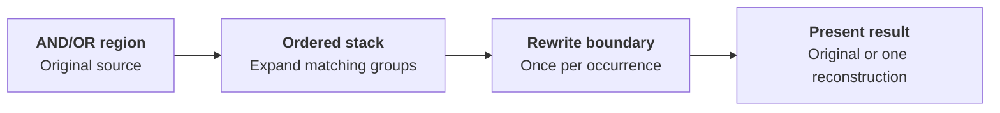

# Logical flattening rewriter

The public rule flattens maximal AND and OR regions in one traversal. NOT and other expression variants use ordinary child traversal.

## Current transformation

```text
AND(AND(a, b), c)           → AND(a, b, c)
AND(AND(a, b), AND(a, b))   → AND(a, b, a, b)
OR(a, OR(b, c))            → OR(a, b, c)
AND(a, OR(b, OR(c, d)))    → AND(a, OR(b, c, d))
AND(a, OR(b, c))           → unchanged
NOT(AND(a, AND(b, c)))     → NOT(AND(a, b, c))
```

Operand order, duplicates, constants and full declared Types are preserved. Unchanged operands retain their original instances; input nodes and child slices remain immutable. Constant folding, duplicate elimination and array grouping belong to other rules. Expression constructors continue to preserve caller grouping.

The rule preserves operand order, exact Types, and per-occurrence evaluation. Broader optimizer integration remains separate.

## Public usage

```go
rule := logical_flattening_rewriter.NewLogicalFlatteningRewriter()
tree := rewriter.NewExpressionTreeRewriter[struct{}](rule)
result, err := tree.Rewrite(input, struct{}{})
```

Inputs must be valid, non-nil and immutable, established once by expressions/utils.ValidateForOptimization or controlled construction preserving graph-wide identity/Type consistency. Successful rewriting preserves validity and equivalence or returns an error; input validity and technique applicability are separate obligations. The rule takes no FunctionContext, evaluation environment or scoped facts and performs no evaluation. When rewriting a descendant changes an enclosing CallExpression, ordinary WithChildren reconstruction can inspect the call's own paired context. Reconstruction and traversal errors propagate without a successful partial tree.

Each invocation is an explicitly scheduled traversal. Run it before scoped attempts are established or after an accepted result has been published, because changing grouping changes occurrence paths. The constructor introduces no automatic pipeline or repetition.

The [runnable public example](../../examples/rewriting/logical_flattening_test.go) prints the source and result, preserves an opposite-operator boundary, checks exact Type and evaluates complete rows including known NULL. From the repository root:

```sh
go test ./examples/... -run '^Example_logicalFlattening$' -v
```

For this rule alone, one pass flattens every matching region and a second unchanged pass returns the same instance. Other rules may subsequently expose new matching groups; whether to schedule another flattening pass belongs to the caller. The example adds no automatic repetition.

## Maximal AND/OR-region traversal

The logical callback uses an explicit stack. Children are pushed in reverse order, so popping preserves source order. Nested nodes with the same operator as the region root are expanded directly instead of being rebuilt separately. Each boundary operand is sent through tree.Rewrite once; opposite-operator groups, NOT and other boundaries can therefore contain separately flattened AND/OR regions.

```text
AND(AND(a, b), OR(c, AND(d, AND(e, f))))
  outer boundaries: a, b, OR(c, AND(d, AND(e, f)))
  rewritten boundary: OR(c, AND(d, e, f))
  result: AND(a, b, OR(c, AND(d, e, f)))
```

The callback rebuilds the region once if a matching nested group was bypassed or a boundary changed. Otherwise it returns the original node as a present result. Both returns finish the occurrence: returning absence after processing its boundaries would traverse them again. NOT returns absence immediately and lets default traversal handle its child. Function calls likewise use inherited traversal, preserving the call while flattening its arguments.



Shared grouping nodes are expanded at each occurrence, retaining repeated operand executions. The algorithm avoids repeatedly copying flattened prefixes of a skewed chain. Measurements support the linear structural-work argument; timing and allocation costs vary by shape. No latency or work-budget guarantee follows from these tests.

## Truth and declared Types

[Semantic fixtures](tests/semantics_test.go) evaluate source and flattened trees independently against explicit three-input AND/OR truth tables. They cover all 27 True/False/NULL assignments for nullable references in left-associated, right-associated and flat groups, plus valid assignments for every mixed-nullability declaration combination.

Truth and declared nullability remain distinct. For example, `AND(False!, AND(NULL?, True?))` becomes `AND(False!, NULL?, True?)`: its value is False, its result Type remains Bool?, and all literal operands remain present. The fixtures also cover known NULL results and wholly non-nullable groups, checking exact result and operand Types with EqualsTo.

## Sharing and idempotence

[Ownership fixtures](tests/ownership_test.go) verify both operators. If `G = AND(a, b)`, then `AND(G, G)` becomes `AND(a, b, a, b)`, retaining the original a/b instances and visiting each occurrence. Shared opposite-operator boundaries and IN operands likewise retain their occurrences. If a shared boundary itself requires flattening, each occurrence can receive a separately rebuilt group; sharing of newly constructed grouping nodes is not required.

Previously returned child slices and all source nodes remain unchanged. A second pass returns the normalized root instance and preserves descendant instances and structural counts. Fixtures with repeated IN operands verify nonzero literal and membership-entry counts, so these preservation checks also cover actual payload-bearing boundaries.

## Evaluation and failures

[Evaluation fixtures](tests/evaluation_behavior_test.go) record reference lookups and unclassified function calls in one ordered trace. Source and flattened AND/OR trees produce the same trace, including repeated calls. For example, `AND(False, AND(pass(a), failFirst(a)), failSecond(b))` still reaches `pass(a)` and then `failFirst(a)`; the decisive False does not suppress the failure. The later failure is never reached. OR with a decisive True behaves similarly under the current eager interpreter. Opaque operands continue to report unavailable evaluation.

Flattening itself records no evaluation or lookup events. A changed call argument triggers reconstruction through the call's paired provider. An injected metadata lookup failure returns the original error cause/category and no partial tree, leaving source nodes and child slices intact. Clearing the fault allows a clean retry; an unchanged subsequent pass requires no metadata lookup. Tests compare error causes and categories because diagnostic child paths may change when grouping disappears.

## Missing inputs and known NULL

[Partial-evaluation fixtures](tests/partial_evaluation_test.go) distinguish an absent binding from a present typed NULL. For `AND(a, AND(b, c))` with `a = NULL`, `b = True` and c missing, source and flattened trees produce residual expressions retaining c. Completing c with False produces False; completing it with True or NULL produces NULL. All results retain Bool?. Fully bound inputs produce known values rather than residuals.

The current eager interpreter also retains missing inputs when another operand is decisive: `False AND missing` remains residual until that input is supplied. Missing inputs can belong to non-nullable columns too; absence is analysis uncertainty rather than a NULL value. Fixtures enumerate all valid True/False/NULL/missing combinations for nullable, non-nullable and mixed declarations, then check every valid completion against the truth oracle. Residual shapes may differ; truth and exact Type must agree. This verification changes no interpreter policy.

## Composition with contextual rewriting

[Composition fixtures](tests/composition_test.go) exercise both explicit schedules:

```text
Input → Flattening → Scoped contextual rewriting → Boolean cleanup
Input → Scoped contextual rewriting → Boolean cleanup → Flattening
```

Every pass completes before the next starts. Flattening therefore operates outside active contextual attempts; later contextual work derives fresh guard paths from the published tree. The tests cover nested guards, independent sibling owners, and a target shared inside two owners and outside both, ensuring guard facts stay scoped to their occurrences.

The schedules can yield different grouping. With non-nullable x, `G = x IN [1, 2]` and nullable Boolean operands a/b:

```text
Input:           AND(G, OR(AND(a, b), x == 3))
Flatten first:   AND(G, AND(a, b))
Flatten last:    AND(G, a, b)
```

Under G, contextual rewriting removes the impossible comparison and exposes the inner AND. An earlier flattening pass has already finished; a later flattening pass absorbs the newly adjacent group. Both results retain the original truth and full Type. These tests do not add automatic repetition.

A separate fixture leaves `AND(G, x == 1, x == 1)` after either schedule. A subsequent contextual/cleanup pair uses a fresh equality guard and reduces it to `x == 1`, demonstrating useful work after previous paths have been retired. All intermediate stages preserve source nodes/child slices, avoid node-count growth and function evaluation during rewriting, and agree under independent interpretation over 324 complete rows per fixture/schedule.

## Touchstone integration

[Touchstone fixtures](tests/touchstone_test.go) add flattening to both schedules and independently construct the expected scalar result. Its outer AND contains article/review/category/brand/mall restrictions followed by seven individual tag exclusions. Category and mall still use singleton `array_contains_any`; tag exclusions still use separate `array_contains` calls. Array normalization/grouping remains separate work.

For non-nullable article_type, both schedules produce the same 63-node scalar tree:

| Schedule | Input | After first pass | After second pass | After third pass |
| --- | --- | --- | --- | --- |
| Flatten → Contextual → Cleanup | 111 / 57 / 46 | 110 / 57 / 46 | 64 / 29 / 19 | 63 / 28 / 19 |
| Contextual → Cleanup → Flatten | 111 / 57 / 46 | 65 / 29 / 19 | 64 / 28 / 19 | 63 / 28 / 19 |

Each entry is **nodes / literals / IN entries**, counting occurrences. These are structural measurements, not runtime benchmarks. The original scoped tests keep their two-pass result and grouping.

Complete-row evaluation checks all stages and the independently constructed result over 680 concrete rows per schedule and 1,734 rows when other fields are nullable. Fixtures include every tag exclusion, review/brand boundaries, duplicate and empty arrays, all nonempty NULL masks on the other fields, and concrete rejection dominating NULL elsewhere.

When article_type is nullable, contextual rewriting and cleanup retain the predicates, while flattening changes grouping: 111 nodes become 110, with 57 literals and 46 IN entries unchanged. With article_type = NULL and tag_ids containing 8791004, every stage still returns NULL; the proposed fully reduced touchstone output would return False. Thus grouping changes remain valid without authorizing that scalar reduction.

## Work measurements

[Benchmarks](tests/flattening_benchmark_test.go) cover left/right/balanced/flat/repeated shapes for AND and OR, with setup excluded. Run from the repository root:

```sh
go test ./concrete_rewriters/logical_flattening_rewriter/tests -run '^$' -bench BenchmarkLogicalFlattening -benchmem
```

These are workload measurements, not production latency guarantees.

Deep-chain regression tests verify 65,536 operands without recursive formatting or equality checks. The collector avoids repeated-prefix reconstruction; its structural work is amortized linear in the collected region. Mixed-operator/boundary traversal remains recursive through the generic tree service. Unchanged identity does not eliminate traversal or scratch allocation.

## Files and verification

| File | Responsibility |
| --- | --- |
| [logical_flattening_rewriter.go](logical_flattening_rewriter.go) | Public constructor and ordered maximal AND/OR-region traversal with checked reconstruction. |
| [Unchanged-tree tests](tests/logical_flattening_rewriter_test.go) | Identity and Type preservation across all expression variants with no nested matching groups, including nullable inputs and shared boundaries; provider access/evaluation is forbidden during unchanged traversal. |
| [Flattening tests](tests/flattening_test.go) | Skewed/balanced/n-ary regions, repeated/shared operands, constants, mixed boundaries, source immutability, structural counts, one boundary callback per occurrence, call reconstruction and failure propagation. |
| [Semantic tests](tests/semantics_test.go) | Independent three-valued truth oracle, nullable/non-nullable declaration combinations, exact result/operand Types and literal preservation. |
| [Ownership tests](tests/ownership_test.go) | Shared operands and boundaries, source/slice immutability, per-occurrence traversal, literal/IN counts and second-pass identity. |
| [Evaluation behavior tests](tests/evaluation_behavior_test.go) | Ordered lookup/call traces, eager failures, first-error preservation, opaque unavailability and reconstruction failure/retry without evaluation. |
| [Partial-evaluation tests](tests/partial_evaluation_test.go) | Missing/NULL distinction, exact residual references and Types, and oracle-checked completions for nullable/non-nullable inputs. |
| [Composition tests](tests/composition_test.go) | Both public pass schedules, scoped shared targets, independently specified shapes, fresh subsequent work and complete-row equivalence at every stage. |
| [Touchstone tests](tests/touchstone_test.go) | Both schedules, independent flat scalar expectation, structural counts, nullable fields and the nullable-article counterexample. |
| [Deep-chain tests](tests/deep_chain_test.go) | Iterative workload construction, large-chain order/Type/count checks and second-pass identity. |
| [Benchmarks](tests/flattening_benchmark_test.go) | Public traversal time and allocations across operators, shapes and sizes, excluding setup. |

From the repository root:

```sh
go test ./concrete_rewriters/logical_flattening_rewriter/...
go test -tags debug ./concrete_rewriters/logical_flattening_rewriter/...
```

Array normalization and grouping are separate passes. General scheduling, revisits, bounded-work fallback, and independent Milvus compatibility validation remain open.
