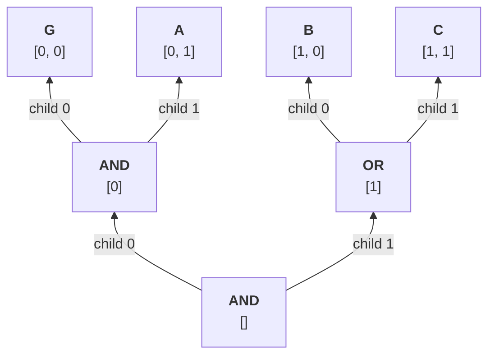
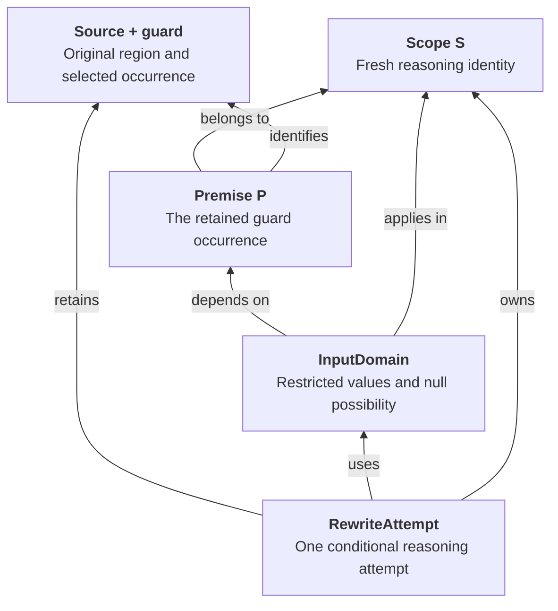
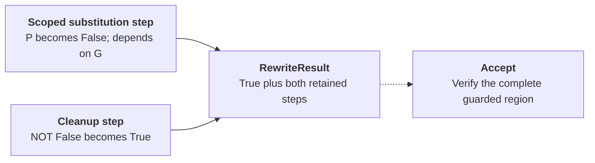
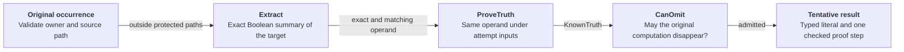
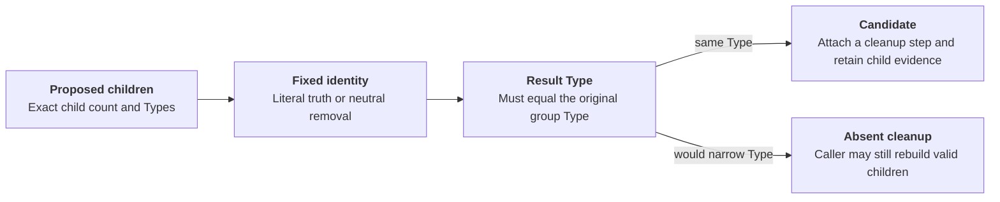
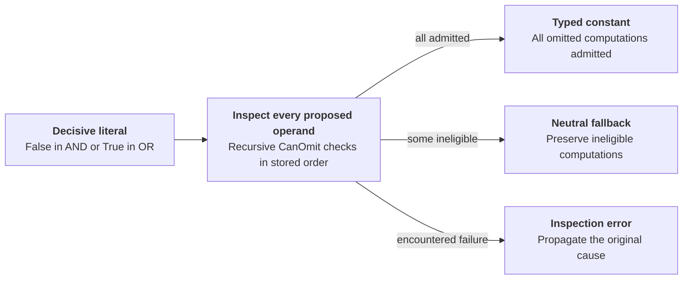
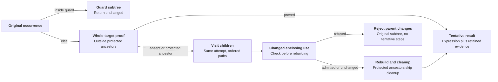
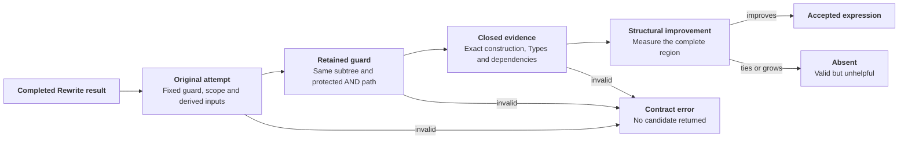
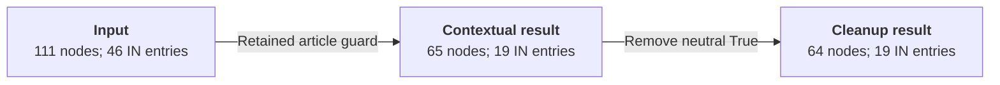

# Scoped contextual rewriting

This package prepares simplifications that use a **retained guard**: one conjunct supplies facts for simplifying other occurrences in the same AND region. Each conditional conclusion must remain justified by that particular guard occurrence.

The public `ScopedContextualRewriter` now simplifies AND regions through guard selection, independent attempts, scoped substitution/cleanup, whole-region acceptance and structural improvement checks. Failed owners leave independent nested regions available to ordinary traversal. The standalone BooleanCleanupRewriter is available as a separate pass. Tests cover scalar domains, shared contexts, provider/failure boundaries, and touchstone integration. Array normalization and grouping are separate passes; general scheduling and bounded work remain open.

The [scoped reasoning README](../../analysis/scoped_reasoning/README.md) explains the underlying domains, scopes and premises.

## Input validity and local proof obligations

Establish valid immutable input once with expressions/utils.ValidateForOptimization, or controlled construction preserving graph-wide canonical identity/Type consistency. Successful rewriting publishes a valid equivalent whole region or returns an error. Stored-call analysis trusts its established signature; changed calls use checked construction. Guard provenance, omission eligibility, exact Types and whole-region acceptance still require their existing proofs. Input validity does not authorize deleting a computation merely because its expression is valid.

## Package layout

```text
scoped_contextual_rewriter/
├── scoped_contextual_rewriter.go   # Public rule and constructor
├── README.md
├── internal/
│   └── engine/                    # Analysis, attempts, proofs and traversal
└── tests/
    ├── scoped_contextual_rewriter_test.go
    └── engine/                    # Internal operation and evidence tests
```

The public rule holds an unexported `*engine.Engine`; it does not embed the engine or expose its methods. Only this package and its descendants may import `internal/engine`, as enforced by Go. Internal operations and records needed by the separate tests use exported names, such as `SelectGuards`, `NewAttempt` and `RewriteAttempt`. Helpers used only within the engine remain unexported.

Engine configuration and constructed records are read-only during production use. Tests may deliberately alter internal records to exercise invalid ownership, stale paths and foreign evidence. This access stays inside the rewriter subtree; the public rule exposes accepted complete replacements through RewriteLogical while keeping attempt internals private.

## Method: restrict locally, preserve the justification

Assume non-nullable Int64 `x`:

```sql
x IN [1, 2] AND NOT(x == 3)
```

If the first conjunct is true, `x` belongs to `{1, 2}`, so `x == 3` is false. The public contextual result is:

```sql
x IN [1, 2] AND TRUE
```

The guard must remain: replacing the whole region with `TRUE` would admit `x = 3`. Logical equivalence also requires preserving NULL results, declared Types and the relevant evaluation behavior.

The implemented public rule follows this flow:

```mermaid
flowchart LR
    S["<b>Original AND region</b><br/>Immutable source tree"]
    C["<b>EnumerateConjuncts</b><br/>Ordered occurrences and paths"]
    G["<b>SelectGuards</b><br/>Exact Bool! summaries and potential targets"]
    A["<b>NewAttempt</b><br/>Fresh scope, one premise, restricted inputs"]
    T["<b>Rewrite / Visit</b><br/>Private traversal, cleanup and evidence rollback"]
    R["<b>Accept</b><br/>Construction, guard, dependencies and size"]
    P["<b>RewriteLogical</b><br/>Publish the accepted complete region"]
    S --> C --> G --> A
    A --> T
    T --> R
    R --> P
```



Here `Bool!` means non-nullable Boolean and `Bool?` means nullable Boolean. The initial guard contract requires declared `Bool!`; finding non-null values among passing rows does not establish that the guard is two-valued everywhere.

## Occurrences: where a guard belongs

An `OccurrencePath` is a sequence of child indexes from the original region root. `[]` denotes the root; `Extended(i)` returns a new path with `i` appended. Retained paths own their slice storage. Resolving a path reads the original tree without rebuilding it.

For `(G AND A) AND (B OR C)`:



`EnumerateConjuncts` traverses only AND nodes, yielding:

| Path | Complete conjunct |
| --- | --- |
| `[0, 0]` | `G` |
| `[0, 1]` | `A` |
| `[1]` | `B OR C` |

The OR remains whole because neither branch individually must be true when the region is true. NOT subtrees also remain whole. Discovery preserves grouping, stored order and the source objects.

If two edges share one immutable `G` object, `[0]` and `[1]` still identify different occurrences. Selecting one as the guard must not freeze both. Path equality identifies the selected occurrence; prefix checks identify its protected ancestors for traversal. Paths belong to a particular source snapshot, not to arbitrary rebuilt trees.

## Selecting possible guards

`SelectGuards` scans the conjunctive view in source order. For each complete conjunct it:

1. Requires a declared `Bool!` result.
2. Uses `ScalarExtractor` to obtain an exact single-operand summary of the whole conjunct.
3. Uses `HasPotentialTarget` to find the same operand in another conjunct subtree.

Each `GuardCandidate` retains its owned path, original expression and exact `PredicateSummary`. Unsupported extraction skips the candidate; encountered provider or analysis errors propagate and discard the partial candidate list. Selection does not install assumptions or evaluate expressions.

`HasPotentialTarget` excludes the entire selected guard occurrence, then scans exposed children in the other conjuncts. It matches `ReferenceExpression` equality: caller-defined column identity plus the full declared Type, including nullability. IDs may be non-comparable Go values. Display names and pointer identity are insufficient. Calls, IN, OR and NOT expose children; opaque contents are unavailable.

| Input, with non-nullable operands | Selection behavior |
| --- | --- |
| `x IN [1, 2] AND NOT(x == 3)` | Both whole conjuncts can be candidates. |
| `(x == 1 OR x == 2) AND NOT(x == 3)` | The complete OR can be a guard; its branches are not separate guards. |
| `x > 0 AND y > 5` | Neither has another same-operand target. |
| `x > 0 AND x > 5 AND x > 10` | Keep all three candidates, in order. |

The last example explains why selection collects alternatives. Assuming `x > 0` fixes neither stronger predicate's truth; a later attempt using `x > 5` can establish `x > 0`. A potential target is an opportunity to investigate, not a successful proof.

Nullable comparisons ordinarily produce `Bool?` and are excluded before extraction. Mixed-operand and unsupported predicates cannot provide an exact single-operand guard summary, although their exposed children may still be potential targets of another guard.

## Constructing a scoped attempt

`NewAttempt` consumes a guard selected for its original source. It relies on selection's AND-only path, complete exact summary and declared Bool! contract. Construction does not repeat extraction or query providers.

For the guard `x IN [1, 2]` at `[0]`:

```text
Initial InputDomain:
    Operand        = original reference x: Int64!
    PossibleValues = all Int64 values
    NullPossible   = false
    Premises       = []

Restricted InputDomain:
    Operand        = the same reference x: Int64!
    PossibleValues = {1, 2}
    NullPossible   = false
    Premises       = [P: guard occurrence at [0] is true]
```

The non-null universe is an empty-exclusion `EquatableValueSet`. Null possibility is represented separately, so the reference's declared Type remains unchanged. `RestrictToTrue` intersects the universe with the guard's true set, handles the null-input outcome and attaches the guard premise.



Scope identity, premise identity and source path have different jobs. The scope separates reasoning environments; the premise identifies the retained assumption; the path locates its source occurrence. Every call creates fresh scope and premise identities, even when retried with the same expression and path. An attempt copies its guard path while sharing immutable expressions, summaries and domains.

Construction distinguishes three outcomes, again with non-nullable `x`:

| Guard | Restricted inputs | Result |
| --- | --- | --- |
| `x IN [1, 2]` | `{1, 2}` | Present attempt: proper, nonempty restriction. |
| `x == 1 OR x != 1` | Entire declared universe | Absent: unchanged inputs. |
| `NOT(x == 1 OR x != 1)` | Empty | Absent: unreachable inputs. |

Errors propagate separately from absence. An unreachable restriction does not authorize replacing the region with false in this step.

The unchanged-domain comparison includes both the non-null set and null possibility. For a future exact two-valued guard equivalent to `x IS NOT NULL`, removing NULL alone would be a proper restriction. A direct producer fixture tests this constructor behavior; the current selector does not extract such opaque guards.

`RewriteContext` pairs an attempt with a current occurrence path. Its `Child(i)` method keeps the same owner and extends the path with independent storage. For example, `[]`, `[1]` and `[1, 0]` can describe successive visits under one attempt. The internal traversal uses these contexts to identify occurrences.

## Recording tentative changes and their evidence

`RewriteStep` records one local derivation; `RewriteResult` records a tentative subtree and the evidence for its retained changes. Their constructors belong to the internal engine API. Scoped substitution and Boolean cleanup record successful changes. The public callback publishes only accepted complete results.

For `G AND NOT(P)`, with `G = x IN [1, 2]` and `P = x == 3`, the records describe this chain; the explicit helper sequence illustrates both records. The integrated traversal tries the whole NOT(P) first and may instead prove it True in one step:

| Step | Original source and path | Before the local change | After | Conclusion |
| --- | --- | --- | --- | --- |
| Scoped substitution | `P` at `[1, 0]` | `P` | `False` | KnownTruth(False), depending on G's premise. |
| Fixed NOT cleanup | `NOT(P)` at `[1]` | `NOT(False)` | `True` | Absent: the fixed identity supplies this local justification. |

The second step's **source** remains `NOT(P)` in the original snapshot. Its **before** expression is the rebuilt `NOT(False)`. The result retains both steps, so removing P from the syntax does not remove the guard dependency.



`NewStep` checks the attempt owner, original path/source identity and exact source/before/after Types. It rejects changes at the guard, inside its subtree or on its protected ancestor path. A truth step must use the attempt's exact input domain, scope and guard premise, describe the original target, and produce the literal matching KnownTruth. A structurally equal but distinct source cannot stand in for the recorded original object.

An absent conclusion is reserved for fixed logical cleanup. The constructor checks that source and before retain the same logical form and child Types; the cleanup helper must establish the actual identity and any required omission eligibility. An absent conclusion alone does not authorize an arbitrary replacement.

`NewRewriteResult` copies its step slice and every retained path. Parents include evidence only from accepted children. A rejected child can return its original expression with no tentative steps, leaving independently retained sibling results intact. Record tests cover ownership rules; attempt traversal implements child traversal and rollback. Rebuilding a parent without an additional local simplification needs no new step.

## Proving a constant at one occurrence

`RewriteAttempt.ProveLiteral` now implements the local substitution step. Given the original target `x == 3` under the guard `x IN [1, 2]`, it keeps the target's exact global true set `{3}`, then asks `ProveTruth` about the attempt's possible inputs `{1, 2}`. Their disjointness establishes False in that scope. It does not turn the restricted input domain into a new global predicate summary.



The guard, its descendants and protected ancestors are excluded from literal substitution. Non-Boolean targets, unsupported extraction, different operands or full Types, inconclusive queries, Unreachable and omission refusal all return an absent optional. Operational errors propagate separately; stale source/path or foreign attempt associations are contract errors.

A successful result contains a literal with the original target's exact Type and one step retaining the scoped conclusion and guard premise. Shared source objects at other paths can still be targets. The helper does not call `Evaluate`, descend into children or publish a complete region. Attempt traversal checks enclosing uses and retains or discards the tentative result as a unit.

### Why both prefix directions are protected

`ProveLiteral` uses this check before extraction:

```go
if a.guard.Path.IsPrefixOf(context.Path) || context.Path.IsPrefixOf(a.guard.Path) {
    return absent, nil
}
```

A path contains ordered child indexes. Prefix matching includes equality, so a prefix identifies the same occurrence or an ancestor. Suppose the guard is at `[0, 1]`:

```text
AND                         []
├─ AND                      [0]
│  ├─ A                     [0, 0]
│  └─ G  ← selected guard   [0, 1]
└─ P                        [1]
```

| Condition | Protected locations | Example current paths |
| --- | --- | --- |
| `Guard.Path.IsPrefixOf(context.Path)` | The guard and its descendants. | `[0, 1]`, `[0, 1, 0]` if G has a child. |
| `context.Path.IsPrefixOf(Guard.Path)` | The guard and its ancestors. | `[0, 1]`, `[0]`, `[]`. |

Neither condition matches A or P, so they remain potential substitution targets, subject to proof and eligibility checks.

The attempt assumes G is true. Using that assumption to replace G with True would erase its own justification. Substituting a constant for an ancestor could also remove the retained guard. Freezing G's entire subtree preserves the original premise occurrence.

Protected ancestors may still be **rebuilt with changed siblings** during private traversal. For example, if P is proved true under G and its computation may be omitted:

```text
(A AND G) AND P
        ↓
(A AND G) AND True
```

The root is rebuilt, but G remains unchanged at `[0, 1]`. Replacing the root itself with a constant is forbidden by the prefix check. `return absent, nil` means “no substitution at this occurrence,” not an error or an instruction to skip all sibling work. Attempt traversal implements this ancestor rebuilding and traversal.

## Evaluation eligibility is a separate obligation

A scoped truth proof establishes a value under assumptions. Removing the computation or changing arguments to an enclosing call also needs evaluation eligibility. Part B supplies two checks:

| Helper | Question | Current behavior |
| --- | --- | --- |
| `CanOmit(Expression)` | May this computation disappear? | Checks admitted operations and recursively checks their operands. |
| `CanChangeChildren(parent, children)` | May this enclosing operation consume changed children? | Checks child count, exact per-position Types and supported original/proposed invocation shapes. |

For example, knowing `P` is false does not alone justify deleting `P` if evaluating it can fail. Similarly, consider a guard that makes `P` false and an enclosing `foo(P)` that fails for false. Outside the guard's true inputs, substituting false might introduce a failure that the original call would not have produced. Unknown changed calls therefore remain unadmitted even when a child has a scoped proof.

An unchanged child list passes `CanChangeChildren` without provider queries. Retained siblings need not be omittable: they remain in their original positions and still evaluate. This distinguishes changing an argument from removing the enclosing computation. Attempt traversal uses rejection to discard tentative child changes and their evidence together.

Current omission admission covers literals, references, logical composition, supported scalar comparisons, Boolean NOT, supported IN shapes, and selected Int64-array membership contracts. IN candidates must be a nonempty list of non-null literals with non-null declared Types. Array membership admits `array_contains` and `array_contains_any` for arrays of non-null Int64 elements; only the input array may be nullable, and contains-any requires a non-null literal candidate array. Arithmetic, arbitrary calls and opaque regions remain conservative boundaries. Array admission does not imply array guard extraction or array-rule implementation.

These checks inspect function identity, paired metadata, effective signatures and null policies. Stored calls retain their own contexts; IN equality uses the context supplied to the rewriter. Correct, stable, effect-free and successful supported invocations, and stable successful reference lookup for valid complete inputs, are caller preconditions. The helpers never probe `Evaluate` to establish those guarantees. Unsupported contracts return false; encountered operational errors propagate.

## Neutral and all-literal Boolean cleanup

Boolean cleanup implements `CleanupLogical(source, children)`. The children are proposed, already-justified child results. The helper checks their count and exact per-position Types, then applies fixed identities without evaluating children or querying providers.

| Case | Example | Result |
| --- | --- | --- |
| Literal NOT | `NOT NULL` | `NULL`, with the original group Type. |
| All literals | `False AND NULL AND True` | `False`, with the original nullable group Type. |
| No survivors after neutral removal | `True AND True` | Typed True; no zero-arity AND is constructed. |
| One survivor | `True AND A AND True` | A, if its full Type equals the group's. |
| Multiple survivors | `True AND A AND True AND (B OR C)` | `A AND (B OR C)`, preserving order and grouping. |
| Expected Type narrowing | `A:Bool! AND True:Bool?` | No cleanup: A alone would change Bool? to Bool!. |

OR removes False as its neutral value. NULL is not neutral for either operator. All-literal evaluation uses three-valued truth: a decisive False/True dominates NULL for AND/OR respectively, while `NOT NULL` remains NULL.



An absent cleanup does not reject previously justified child changes. For example, after a Bool? child becomes `True:Bool?`, the parent may retain `A:Bool! AND True:Bool?` rather than narrow the result to A.

Neutral cleanup alone retains nonliteral computations beside decisive literals. Absorption requires the separate omission checks described below.

After a successful cleanup, the caller keeps earlier proof evidence and adds the cleanup step. The implemented private test combines scoped substitution (`P -> False`) with Boolean cleanup (`NOT False -> True`); its result still depends on the retained guard. Attempt traversal performs traversal and evidence accumulation automatically within an attempt.

## Absorbing cleanup checks omitted computation

With omission checks, `CleanupLogical` supports `A AND False -> False` and `A OR True -> True`. A decisive literal establishes the result's value, but suppressing A's computation requires `CanOmit(A)` as well. Every proposed operand occurrence is checked, recursively, before a mixed literal/nonliteral group is replaced with a constant.



| Input | Eligibility | Result |
| --- | --- | --- |
| `(x < 10) AND False` | Supported scalar comparison and stable reference read. | False with the original group Type. |
| `array_contains(ids, 1) OR True` | The supported Int64-array invocation and all arguments are admitted. | True with the original group Type, including nullability. |
| `unknown_call() AND False` | Unknown call is ineligible. | No absorbing replacement. |
| `True AND unknown_call() AND False` | Unknown call is ineligible. | Remove only the neutral True; retain the call and False. |

Inspection continues past ineligible operands: an opaque first child cannot hide a later metadata failure. A shared object appearing twice is inspected at both occurrences. The checks use the proposed child expressions, since those are the computations the cleanup would remove. Metadata/equality lookups may occur, but no evaluation occurs during optimization.

If `unknown_call()` fails, it still fails after neutral fallback. The independent interpreter tests verify this for both AND and OR. A decisive Boolean value alone cannot suppress a retained computation's failure.

Evidence also survives absorption. For retained G and a scoped proof that P is false, the tested private chain is:

```text
P -> False                scoped conclusion depends on G
A AND False -> False      fixed identity after omission admission
NOT False -> True         fixed NOT identity
```

The result retains all three steps. The first step still carries G's premise even though P and A have disappeared from the tentative subtree. Attempt traversal performs this chain automatically when whole-target analysis is unsupported; acceptance checks the complete region with those dependencies intact.

## Typed constants preserve declarations

`TruthLiteral` constructs True or False under the original `Bool!` or `Bool?` Type, and Null under `Bool?`. It shares that Type rather than narrowing it because a value is known. Null under Bool! and invalid truth values return contract errors.

For example, a later proof that a `Bool?` target is always true must produce `True:Bool?`. Constructing `True:Bool!` would change the target's declared Type. Scoped substitution now uses this helper for admitted scoped substitutions. Known-NULL and nullable-operand cases are separately tested with direct producer fixtures, beyond current guard selection.

## Private occurrence-aware traversal

Attempt traversal connects the helpers through `RewriteAttempt.Rewrite()` and `Visit(source, context)`. The result is a tentative complete region plus retained evidence. The public callback now invokes this traversal and publishes its result only after Accept succeeds.

At each original occurrence, traversal follows this order:

1. Validate the context's owner and original source association. Return the selected guard subtree unchanged.
2. Outside the protected ancestor path, try a proof of the entire original target. A successful proof finishes that occurrence immediately.
3. Otherwise visit children in stored order, under the same attempt and with extended source paths.
4. If children changed, check the enclosing use before rebuilding. Refusal restores the entire original parent subtree and discards all steps beneath it.
5. Rebuild admitted child changes. Protected AND ancestors skip cleanup; other logical groups apply cleanup and append any local step after the retained child steps.



For `G AND foo(P) AND P`, suppose G proves P true but foo is unadmitted for changed arguments. The visit inside foo tentatively produces True; the enclosing-use check rejects that change and returns the original `foo(P)` without its tentative evidence. The separate sibling P can still become True:

```text
G AND foo(P) AND P
            ↓
G AND foo(P) AND True
```

The resulting evidence contains only the sibling's step at `[2]`. If `foo(false)` fails when G is false, its original failure remains. Tests verify that behavior through independent interpretation.

Each visit uses its occurrence path and the current attempt's inputs. A shared P can therefore become True under one attempt and False under another without cached facts leaking between them. The traversal creates no independent nested owner: an inner AND uses only the outer attempt's existing restriction. Errors return no partial tree or evidence. Step construction and immutable rebuilding preserve exact intermediate Types; guard identity stays fixed at its original path.

A candidate can contain protected ancestor groups such as `G AND True`. The engine first accepts and publishes the complete region. Use a separately invoked `BooleanCleanupRewriter` in `concrete_rewriters/boolean_cleanup_rewriter/` to collapse such groups when Types permit. Both rewriters now reuse local cleanup and required eligibility helpers from `concrete_rewriters/internal/boolean_cleanup/`; guard paths and proof bookkeeping remain in this engine. Its proof and traversal code call the shared helpers directly.

## Structural improvement of a complete region

`engine.Improves(sourceSize, candidateSize)` implements the structural improvement policy. Measure the original region and the complete tentative replacement with `reconstruction.MeasureExpression`, then prefer a strictly smaller pair:

```text
(NodeCount, NodeCount - LiteralOccurrences)
```

Fewer occurrences win first. At equal occurrence count, more literals win. Larger candidates and ties are rejected. `MembershipEntries` remains a separate diagnostic count; changing it alone does not establish improvement. Shared subtrees count once per occurrence, not once per object.

For non-nullable Int64 x, let `G = x IN [1, 2]` and `P = x == 3`. For non-nullable Boolean g:

| Complete region change | Source pair | Candidate pair | Structural improvement |
| --- | --- | --- | --- |
| `G AND NOT(P)` → `G AND True` | `(9, 6)` | `(6, 3)` | Yes: fewer occurrences. |
| `g AND g` → `g AND True` | `(3, 3)` | `(3, 2)` | Yes: equal size, fewer nonliteral occurrences. |
| `G AND (P OR P)` → `G AND (False OR False)` | `(12, 8)` | `(8, 4)` | Yes: both occurrences of shared P count. |
| `G AND True` → an equal copy | `(6, 3)` | `(6, 3)` | No: a tie retains the original. |
| `g AND g` → `g AND True AND True` | `(3, 3)` | `(4, 2)` | No: the complete region grew. |

The helper compares valid measurements in constant time without allocation or evaluation. It does not establish equivalence, validate evidence or promise lower runtime. Acceptance applies this policy after checking the complete candidate's guard retention and proof dependencies. The public callback uses the accepted result as the public replacement.

## Accepting the complete guarded result

`RewriteAttempt.Accept(result)` consumes the completed result from `Rewrite`, checks its justification, and returns either the accepted expression, absence for no structural improvement, or an error. `RewriteLogical` publishes a result only after successful acceptance.

For `G = x IN [1, 2]`, consider `G AND NOT(A AND x == 3)`, where A is an eligible Boolean reference. The traversal can record:

```text
x == 3 -> False          scoped proof depends on G
A AND False -> False     fixed cleanup after omission checks
NOT False -> True        fixed cleanup
```

Acceptance receives the entire `G AND True`, together with all three steps. The first dependency remains relevant even though `x == 3` has disappeared. If A is nullable, the constant and complete region retain their original nullable Types.

Attempt and result state is private. `NewAttempt` retains one set of source, guard, scope, premise and derived input associations; accessors share immutable objects and copy mutable paths. Each step's source, Type and proof dependencies are checked during construction. After traversal and rollback finish, `Rewrite` marks the result with its completing attempt's identity. Subtree `Visit` results and manually assembled `NewRewriteResult` values have no completed owner and cannot be accepted. `Steps()` returns copies of the evidence slice and paths, so callers cannot alter completed evidence. No duplicate attempt or result snapshot is retained.



| Candidate or evidence | Outcome |
| --- | --- |
| Original completed `G AND True`, with retained dependency chain | Accept if the complete region improves. |
| Completed unchanged source | Absence; preserve the source. |
| Guard moved, replaced by an equal copy, or placed below OR | Contract error. |
| Attempt inputs or completed evidence altered through an accessor | Accessors expose no mutable internal state. |
| Manually assembled evidence or a completed result borrowed from another attempt | Contract error: missing or foreign completed owner. |
| Equal or enlarged candidate assembled outside the recorded traversal | Contract error: equivalence alone supplies no construction evidence. |
| Combining two attempts to delete each other's guard | Contract error: neither premise remains justified. |

Acceptance repeats no scalar extraction, set reasoning, provider queries or evaluation. It checks attempt associations, result Type, retained guard and completing owner; local step validation has already occurred during the encapsulated traversal. It then applies `Improves`. The current traversal never grows a valid candidate; separate policy tests cover the larger-measure rejection policy. No partly rebuilt result escapes on an error.

## Public traversal and fallback

`ScopedContextualRewriter.RewriteLogical` selects guards for an AND region and tries them in stored order. Each useful restriction creates a fresh attempt; the first result passing `Accept` becomes the replacement. A provider or contract error stops the operation without a partial replacement.

```go
rule := scoped_contextual_rewriter.NewScopedContextualRewriter(factory, functionContext)
tree := rewriter.NewExpressionTreeRewriter[struct{}](rule)
result, err := tree.Rewrite(input, struct{}{})
```

No caller-supplied facts are needed. When all attempts decline, the absent callback result lets the generic tree service visit the original children with empty scope. OR and NOT also use this default descent. For example:

```text
A AND ((G AND P) OR B)
              ↓
A AND ((G AND True) OR B)
```

Here `G = x IN [1, 2]` and `P = NOT(x == 3)`. The outer region cannot derive a supported guard from A or the mixed OR, but ordinary descent reaches `G AND P` and establishes its own scope. The same independence holds when an outer guard was usable but produced no improvement: its restriction does not become an implicit assumption for a nested owner.

Later alternatives remain available. For non-null Int64 x:

```text
x > 0 AND x > 5 AND x > 10
                 ↓
True AND x > 5 AND x > 10
```

The first guard, `x > 0`, determines neither stronger comparison. The next guard, `x > 5`, proves the first comparison true and yields the first accepted result. The callback then stops; it does not continue to the third guard looking for a different result.

A present replacement finishes that occurrence without another traversal of its children. Therefore a successful outer owner does not immediately launch independent nested owners inside its replacement. Repeating passes and removing protected neutral conjuncts such as `G AND True` are explicit orchestration choices. Invoke the standalone Boolean cleanup pass to remove eligible neutral conjuncts.

[Public integration tests](tests/contextual_rewriting_test.go) verify generated structure, independent complete-row evaluation, exact Types, non-growth, shared occurrences, source immutability, repeated rule use and zero optimization-time evaluations. They also check errors during selection, a partially progressed attempt and default descent: each returns no partial tree.

## Explicit Boolean cleanup after acceptance

Invoke the independent [BooleanCleanupRewriter](../boolean_cleanup_rewriter/README.md) on the accepted expression:

```go
contextual := rewriter.NewExpressionTreeRewriter[struct{}](
    scoped_contextual_rewriter.NewScopedContextualRewriter(factory, functionContext))
cleanup := rewriter.NewExpressionTreeRewriter[struct{}](
    boolean_cleanup_rewriter.NewBooleanCleanupRewriter(factory, functionContext))
intermediate, err := contextual.Rewrite(input, struct{}{})
if err != nil {
    return nil, err
}
return cleanup.Rewrite(intermediate, struct{}{})
```

For non-nullable x, the two passes produce:

```text
G AND NOT(x == 3)  --contextual-->  G AND True  --cleanup-->  G
where G = x IN [1, 2]
```

The second traversal holds no old attempt, premise or guard path. It can collapse a protected ancestor after acceptance retires that occurrence tracking. If the original group is Bool? but G is Bool!, however, G AND True:Bool? remains because collapsing it would narrow the result Type. Later contextual passes construct fresh paths and domains from their new input.

Both rewriters use the same [shared Cleaner](../internal/boolean_cleanup/cleaner.go). Contextual traversal owns conditional proofs and checks protected paths; standalone cleanup applies unconditional identities in post-order. No cleanup or eligibility logic is duplicated. [Composition tests](tests/cleanup_composition_test.go) verify both ordinary and shifted guard paths, preserved nullable Types, later contextual passes and a small touchstone-style impossible tsa_04 clause.

## Scalar-domain and shared-context verification

Composition coverage checks the public contextual pass and standalone cleanup together on Boolean, Int64, VARCHAR, Float32 and Float64. [Scalar-domain fixtures](tests/scalar_domains_test.go) independently evaluate all three trees—source, accepted intermediate and cleaned result—and compare them with expected native payload truths. They check exact declared Types, source immutability, non-growth and zero evaluation during rewriting.

| Case | Required behavior |
| --- | --- |
| `x < 0 AND x < 1` | The contextual pass produces `x < 0 AND True`; cleanup retains `x < 0`. |
| `(x != 0) AND (x < 0 OR x > 0)` for float | NaN satisfies the guard but fails the ordered disjunction; the result must remain false there. |
| `x IN [NaN, 0] AND x == 0` | The guard admits both signed zeros, excludes NaN and is sufficient after cleanup. |
| Nullable guard | Retain the nullable guard boundary; a NULL input must retain its three-valued result. |
| Nullable target becomes a known constant | Preserve its full declared Type, even when that prevents collapsing the whole group. |

[Shared-context fixtures](tests/shared_context_test.go) place one target instance under two independent guards and outside both owners, using separate guard, target and membership providers. Equal column IDs on distinct reference objects still match, while conclusions remain local to occurrences. Missing scalar or Boolean input produces a residual; present NULL produces a known typed value where determined. Completing residual bindings verifies semantics without requiring the residual trees to look alike.

[Private proof fixtures](tests/engine/scalar_domains_test.go) inspect per-attempt premise and scope ownership for all five scalar domains. The public samples include boundary neighbors, integer extrema, string ordering cases and float exceptional values. They are representative finite test domains; other integer widths remain analysis-supported until the testbed supplies their execution overloads.

## Provider and failure boundaries

[Public boundary tests](tests/provider_boundaries_test.go) exercise both passes. An unknown enclosing call can reject a tentative child change while an independent sibling still simplifies:

```text
G = x == 1; P = x == 1; foo(false) fails
G AND foo(P) AND P
    contextual -> G AND foo(P) AND True
    cleanup    -> G AND foo(P)
```

The occurrence inside foo remains unchanged. At x=2 the guard is false, but eager evaluation still reaches foo(false) and preserves its error. Similarly, a division that is safe only when a guard passes remains executable outside the guard: `x == 1 AND ((1/x > 0) AND False)` still fails at x=0. A known false or NULL result does not authorize suppressing an unadmitted operand's computation.

Supported enclosing comparisons may consume changed arguments while retaining failing sibling arguments in their original positions. Tests check both positions, logical absorption and null propagation, including exact failure counts under independent interpretation. Optimization itself calls Evaluate zero times. A separate repeated-comparison fixture verifies that admitted omission reduces execution from two comparisons to one while preserving truth and Type.

Metadata, lookup and binding failures retain their error categories and return no partial tree. Tests inject faults after valid construction and verify clean retries after removing the fault. Setup also rejects a foreign handle/context pair before a CallExpression exists.

[Independent interpreter fixtures](../../interpreter/tests/provider_contract_test.go) cover supported equality metadata without available/permitted execution and an IN equality failure after an earlier match. These configurations violate the optimizer's provider preconditions; the tests establish interpreter behavior without running either rewriter.

## Automatic touchstone scalar reductions

Touchstone [integration tests](tests/touchstone_test.go) use the full [touchstone Input](../../testbed/touchstone/touchstone.go). Guard discovery and conditional substitutions run through the public contextual rule, followed by a separate Boolean cleanup traversal.



The article guard excludes tsa_04, so the corresponding negated array/article conjunction becomes True. It also implies four broader article memberships, leaving their tag exclusions unconditional. The contextual result keeps its protected root and the neutral True; the independent cleanup pass removes that conjunct. Seven separate tag exclusions and the category/mall contains-any calls remain. Array normalization and grouping are provided by separate passes.

The expected scalar trees are independently assembled from columns and constants. Tests check exact Types, the retained original article guard, unchanged unaffected conjuncts, non-growth and immutable inputs. They independently interpret source and both generated stages on 680 non-null-schema rows and 1,734 nullable-other-field rows. An ordinary membership/three-valued oracle covers passing and failing restrictions, duplicate/empty arrays and all combinations of nullable non-article fields.

With nullable article_type, neither pass changes the fixture. For article_type=NULL and tag_ids=[8791004], its result remains NULL; the proposed final reduced fixture would yield False. This counterexample checks the schema boundary without treating that proposed output as the expected scalar result.

## Runnable public example

[scoped_contextual_rewriting_test.go](../../examples/rewriting/scoped_contextual_rewriting_test.go) constructs `x IN [1, 2] AND NOT(x == 3)`, then explicitly runs the contextual and Boolean cleanup rules through `ExpressionTreeRewriter[struct{}]`. The checked example output prints the original, accepted `G AND True`, and cleaned `G` trees, confirms exact Type preservation, and independently compares all stages at x=1, 2, 3 and 4.

From the repository root:

```sh
go test ./examples/... -run '^Example_scopedContextualRewriting$' -v
```

The example uses the standard testbed provider and stable complete bindings. Production providers must satisfy the same documented complete-domain execution and null-policy preconditions; handles remain paired with their contexts. No premise, path, engine record or eligibility interface is supplied by the caller. This is one contextual pass followed by one cleanup pass, with no implicit fixed-point iteration.

## Code and verification map

| File | Implemented responsibility |
| --- | --- |
| [scoped_contextual_rewriter.go](scoped_contextual_rewriter.go) | Public constructor, provider preconditions, ordered owner attempts and accepted replacement publication. |
| [acceptance.go](internal/engine/acceptance.go) | Complete construction, retained guard, closed dependencies and final improvement gate. |
| [improvement.go](internal/engine/improvement.go) | Strict complete-region structural improvement comparison. |
| [engine.go](internal/engine/engine.go) | Internal engine construction and shared analysis configuration. |
| [attempt.go](internal/engine/attempt.go) | Occurrence paths, attempt/context records and scoped restriction construction. |
| [guards.go](internal/engine/guards.go) | Conjunct discovery, potential-target screening and exact guard selection. |
| [Shared eligibility.go](../internal/boolean_cleanup/eligibility.go) | Omission and changed-enclosing-use checks called directly by the engine. |
| [traversal.go](internal/engine/traversal.go) | Private ordered traversal, protected guard retention, parent rollback and evidence accumulation. |
| [proof.go](internal/engine/proof.go) | Scoped truth queries, omission admission and tentative typed literal substitutions. |
| [result.go](internal/engine/result.go) | Checked local steps, tentative results and owned evidence storage. |
| [Shared cleanup.go](../internal/boolean_cleanup/cleanup.go) | Typed truth literals and local Boolean cleanup called directly by the engine. |
| [Shared cleanup](../internal/boolean_cleanup/cleanup.go), [eligibility](../internal/boolean_cleanup/eligibility.go) | Single implementation of Boolean identities and their evaluation checks. |

[Internal engine tests](tests/engine/) live separately from implementation under `tests/engine/`. [Public tests](tests/scoped_contextual_rewriter_test.go) remain under `tests/`. Fixtures cover independent paths and identities, complete-candidate summaries, nullable exclusions, provider failures, omission boundaries and unchanged/unreachable restrictions.

From the repository root:

```sh
go test ./concrete_rewriters/scoped_contextual_rewriter/...
go test -tags debug ./concrete_rewriters/scoped_contextual_rewriter/...
```

The debug tag enables the shared nil-precondition assertions. `make check` runs lint and the full suite in both configurations, using the configured linter.

## Limitations

General optimizer orchestration, bounded-work fallback, and live Milvus compatibility validation remain open. Apply array normalization and grouping as separate passes when their admission contracts hold.
